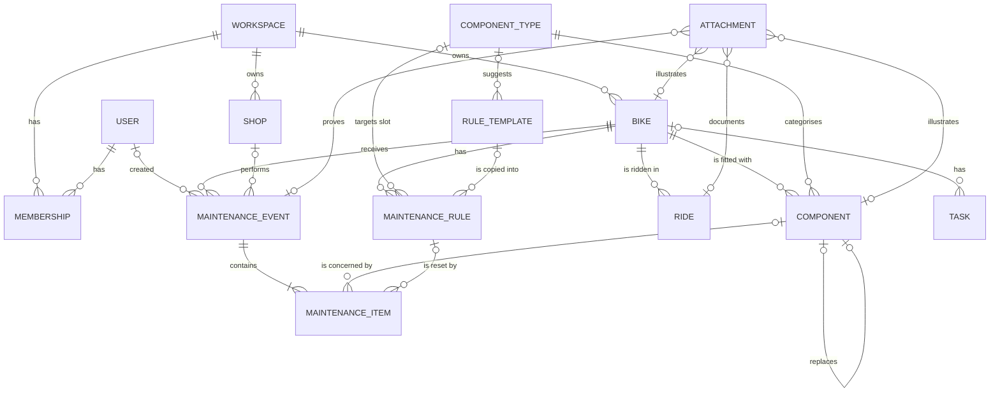

# Data model

Target database: SQLite, with the schema written in Drizzle ORM (see
[04-architecture.md](04-architecture.md#stack)). Types below are logical types;
[Conventions](#conventions) gives the SQLite mapping.

Status: **Proposed**. Simplifications that follow from decisions: one user to start with, but
users and workspaces modelled from day one (D-25), components never change bike (D-05), bike
park fields (D-06), files stored (D-07).

## Overview



Two ideas carry the model:

1. **Usage is never typed twice.** Kilometres and hours live on rides only. Bike, component and
   rule counters are computed from rides (see [Wear counters](#wear-counters)).
2. **Rules target a slot, not a part.** "Check the chain every 500 km" belongs to the
   *chain slot* of a bike (bike + component type + position). When the chain is replaced, the
   rule stays and its counter restarts.

## Users and workspaces (D-25)

A **workspace** owns the data: a rider's garage today, possibly a shop's workshop one day.
**Users** belong to workspaces through **memberships**. At first launch, a setup screen creates
the first user and their workspace; nothing else exists until multi-user features are needed.

| Table | Fields | Notes |
|-------|--------|-------|
| `users` | `id`, `email` (unique), `name`, `created_at` | Password hashes and sessions are stored in the auth library's own tables (`account`, `session`) |
| `workspaces` | `id`, `name`, `created_at` | "My garage" |
| `memberships` | `user_id`, `workspace_id`, `role` (`owner` for now; `member`, `mechanic`… later), `created_at` | Primary key (`user_id`, `workspace_id`) |

Scoping rules:

- Tables at the top of the hierarchy carry a `workspace_id`: `bikes`, `shops`, `tasks`, and the
  custom `rule_templates` (`workspace_id` null = built-in template shared by everyone).
- Everything below a bike (components, rides, maintenance, rules, readings, setups,
  attachments) inherits the workspace through `bike_id`, so no extra column is needed there.
- Per-person data carries a `user_id`: Garmin integration (each person has their own Garmin
  account), notification preferences, sessions.
- `maintenance_events.created_by` records who logged the work (useful for a shop's mechanics).
- Every server-side query goes through one data-access layer that receives the current user
  and workspace. No page or action queries the database directly. This is what makes adding
  real multi-user features later a matter of UI, not a rewrite.

## Core tables

### `bikes`

| Field | Type | Notes |
|-------|------|-------|
| `id` | integer PK | |
| `workspace_id` | FK `workspaces`, required | D-25 |
| `name` | text, required, unique per workspace | "Spectral", "Gravel alu" |
| `discipline` | enum: `road`, `gravel`, `xc`, `trail`, `enduro`, `dh`, `dirt`, `city`, `other` | |
| `is_electric` | boolean | e-MTB, e-gravel… (an e-bike can be any discipline) |
| `brand`, `model` | text | |
| `model_year` | integer | |
| `frame_size` | text | "L", "56" |
| `wheel_size` | text | "29", "27.5", "mullet", "700c" |
| `color` | text | |
| `frame_serial` | text | For the theft or insurance file |
| `weight_g` | integer | Optional |
| `purchase_date` | date | |
| `purchase_price_cents` | integer | Optional (Q-08) |
| `purchase_shop_id` | FK `shops` | Optional |
| `bought_used` | boolean | |
| `initial_distance_m`, `initial_wear_s` | integer | Usage before tracking started (second-hand bike, history not entered) |
| `status` | enum: `active`, `stored`, `sold`, `stolen`, `retired` | Bikes are never deleted, only retired |
| `status_changed_on` | date | |
| `sale_price_cents` | integer | |
| `cover_attachment_id` | FK `attachments` | Main photo |
| `notes` | text | |
| `created_at`, `updated_at` | timestamp | |

### `component_types` (reference data, seeded)

| Field | Type | Notes |
|-------|------|-------|
| `code` | text PK | `fork`, `rear_shock`, `dropper_post`, `chain`, `cassette`, `chainring`, `crankset`, `bottom_bracket`, `rear_derailleur`, `shifter`, `brake`, `brake_pads`, `rotor`, `wheel`, `tire`, `headset`, `pedals`, `saddle`, `handlebar`, `stem`, `grips`, `motor`, `battery`, `display`, `frame`, `other`… |
| `label` | text | UI label, in French (H-01) |
| `group` | enum: `suspension`, `drivetrain`, `brakes`, `wheels`, `cockpit`, `frame`, `electric`, `other` | Grouping on the bike page |
| `has_position` | boolean | `true` for tyres, wheels, brakes, pads, rotors (front/rear) |
| `single_slot` | boolean | At most one fitted part per bike and position (checked by the app) |

### `rule_templates` (reference data, seeded, editable)

Default intervals offered when a component is created. They are only suggestions, to be
adjusted to each part's manual.

| Field | Type | Notes |
|-------|------|-------|
| `id` | integer PK | |
| `workspace_id` | FK, nullable | `null` = built-in template; otherwise a custom one (D-25) |
| `component_type_code` | FK, nullable | `null` = bike-level template (e.g. yearly check) |
| `title` | text | "Lower leg service" |
| `interval_distance_m`, `interval_wear_s`, `interval_days` | integer, nullable | At least one is set; whichever comes first |
| `source` | enum: `manufacturer`, `common_practice`, `personal` | |
| `source_url`, `notes` | text | Where the number comes from |

Seed examples:

| Component | Rule | Interval | Basis |
|-----------|------|----------|-------|
| Fork (RockShox) | Lower leg service | 50 h | RockShox support page: 50 ride hours for the lower legs, 100/200 h services depending on model year. Read through a search summary because the page blocks direct fetching; re-check in the part's manual |
| Rear shock (RockShox) | Air can service | 50 h | Same source |
| Fork or shock (Fox) | Full service | 125 h or yearly | **Unverified**: quoted by retailers, others say 100 h. Check the manual |
| Chain | Wear check | 500 km | **Estimate** (common practice) |
| Hydraulic brakes | Bleed | 365 days | **Estimate** |
| Tubeless tyres | Sealant top-up | 90 days | **Estimate** |
| Bike | General check | 365 days | **Estimate** |

### `components`

| Field | Type | Notes |
|-------|------|-------|
| `id` | integer PK | |
| `bike_id` | FK `bikes`, required, never changes | D-05 |
| `type_code` | FK `component_types` | |
| `position` | enum: `front`, `rear`, `none` | |
| `brand`, `model` | text | "RockShox", "ZEB Ultimate" |
| `reference` | text | Manufacturer part number or SKU |
| `specs` | JSON | Free key/values: `{"travel_mm": 170, "offset_mm": 44}` |
| `origin` | enum: `stock`, `replacement`, `upgrade` | `stock` = part of the original spec sheet |
| `replaces_component_id` | FK `components`, nullable | The part it replaced in the same slot: one history chain per slot |
| `installed_at` | timestamp | Rides from this instant on count towards its wear |
| `initial_distance_m`, `initial_wear_s` | integer | Usage before it was fitted (second-hand part) or before tracking started |
| `removed_at` | timestamp, nullable | `null` = currently fitted |
| `removal_reason` | enum: `worn`, `broken`, `crash`, `upgrade`, `sold_with_bike`, `other` | Feeds phase 3 |
| `purchase_date`, `purchase_price_cents`, `shop_id` | | Optional |
| `warranty_until` | date | |
| `notes` | text | |

### `rides`

| Field | Type | Notes |
|-------|------|-------|
| `id` | integer PK | |
| `bike_id` | FK `bikes`, required | |
| `started_at` | timestamp | |
| `title` | text | Optional |
| `location` | text | Free text, autocompleted from previous rides ("Les Gets", "Forêt de …") |
| `ride_type` | enum: `road`, `gravel`, `xc`, `trail`, `enduro`, `dh`, `bike_park`, `commute`, `indoor`, `other` | |
| `lift_assisted` | boolean | Bike park, shuttles. Defaults to `true` when `ride_type = bike_park` |
| `distance_m` | integer | Total recorded distance |
| `descent_distance_m` | integer, nullable | Distance ridden downhill on lift days |
| `total_time_s` | integer | Total time of the day (D-06) |
| `moving_time_s` | integer, nullable | Given by Garmin, optional by hand |
| `descent_time_s` | integer, nullable | Descent time only (D-06) |
| `runs_count` | integer, nullable | Number of runs (D-06) |
| `elevation_gain_m`, `elevation_loss_m` | integer, nullable | |
| `conditions` | enum: `dry`, `wet`, `mud`, `dust`, `snow`, `mixed`, nullable | Cheap to enter, useful for phase 3 |
| `notes` | text | |
| `source` | enum: `manual`, `garmin_api`, `file_import` | |
| `external_activity_id` | FK `external_activities`, nullable | Phase 2 |
| `created_at`, `updated_at` | timestamp | |

Validation: at least one of `total_time_s` and `moving_time_s` is set.

### `shops`

| Field | Type |
|-------|------|
| `id` | integer PK |
| `workspace_id` | FK `workspaces` |
| `name`, `city`, `phone`, `website`, `notes` | text |

### `maintenance_events`

One visit to the shop or one session in the garage.

| Field | Type | Notes |
|-------|------|-------|
| `id` | integer PK | |
| `bike_id` | FK `bikes` | |
| `performed_on` | date | |
| `title` | text | "Pre-season service" |
| `performed_by` | enum: `self`, `shop` | |
| `shop_id` | FK `shops`, nullable | |
| `created_by` | FK `users` | Who logged it (D-25) |
| `total_cost_cents` | integer | Entered, or the sum of the items |
| `notes` | text | |

### `maintenance_items`

What was done during an event. A shop service often covers several interventions (chain +
cassette + pads + bleed): each one can reset its own rule and point to its own part.

| Field | Type | Notes |
|-------|------|-------|
| `id` | integer PK | |
| `event_id` | FK `maintenance_events` | |
| `action` | enum: `replaced`, `serviced`, `inspected`, `adjusted`, `cleaned`, `lubricated`, `bled`, `trued`, `other` | |
| `component_id` | FK `components`, nullable | The part concerned (for `replaced`: the part removed) |
| `new_component_id` | FK `components`, nullable | For `replaced`: the part fitted |
| `rule_id` | FK `maintenance_rules`, nullable | This item fulfils the rule, so its counter restarts |
| `description` | text | |
| `cost_cents` | integer | Optional |
| `measurement_value`, `measurement_unit` | real, text | E.g. chain stretch 0.5 %, pad thickness 1.2 mm. Feeds phase 3 |

**"Replace a part" flow (one screen):** pick the old part, give a removal reason, then enter
the new part (prefilled from the old one, or from a "part to order" task). The app sets
`removed_at` on the old part, creates the new one with `replaces_component_id`, and records the
item. Rules on that slot restart if `reset_on_replacement` is set.

### `maintenance_rules` — "what's coming", recurring

| Field | Type | Notes |
|-------|------|-------|
| `id` | integer PK | |
| `bike_id` | FK `bikes`, required | |
| `component_type_code`, `position` | nullable | The slot targeted. `null` = bike-level rule |
| `template_id` | FK `rule_templates`, nullable | Where the rule came from |
| `title` | text | |
| `interval_distance_m`, `interval_wear_s`, `interval_days` | integer, nullable | At least one is set; whichever comes first |
| `warn_ratio` | real, default `0.9` | "Due soon" from 90 % of any interval (**Proposed**) |
| `reset_on_replacement` | boolean, default `true` | Replacing the slot's part restarts the counter |
| `start_from` | timestamp | Counter start when the rule has never been done |
| `active` | boolean | |
| `snoozed_until` | date, nullable | |
| `notes` | text | |

### `tasks` — "what's coming", one-off

| Field | Type | Notes |
|-------|------|-------|
| `id` | integer PK | |
| `workspace_id` | FK `workspaces`, required | Tasks may have no bike, so they carry the workspace themselves |
| `bike_id` | FK `bikes`, nullable | `null` = general ("buy a torque wrench") |
| `component_type_code`, `position` | nullable | Optional slot |
| `kind` | enum: `todo`, `part_to_order` | |
| `title` | text | |
| `due_on` | date, nullable | |
| `status` | enum: `open`, `ordered`, `received`, `done`, `cancelled` | |
| `part_reference`, `part_url` | text | For `part_to_order` |
| `estimated_price_cents` | integer | |
| `priority` | enum: `low`, `normal`, `high` | |
| `done_at` | timestamp | |
| `notes` | text | |

### `attachments` — photos, invoices, manuals, tracks

| Field | Type | Notes |
|-------|------|-------|
| `id` | integer PK | |
| `bike_id`, `component_id`, `maintenance_event_id`, `ride_id`, `task_id` | FK, nullable | **Exactly one** is set (CHECK constraint) |
| `kind` | enum: `photo`, `invoice`, `manual`, `track`, `other` | |
| `storage_path` | text | Relative to the data directory, e.g. `uploads/2026/10/<random>.jpg` |
| `original_name`, `mime_type` | text | |
| `size_bytes` | integer | |
| `sha256` | text | Duplicate detection and integrity checks |
| `width_px`, `height_px`, `taken_at` | | Photos |
| `caption` | text | |
| `created_at` | timestamp | |

Files live on disk, never in the database. Derived files (thumbnails, resized copies) go to a
separate `cache/` folder: they can be regenerated, so they are left out of the backups.

### `readings` — e-bike values read from the motor system (D-19)

Bosch exposes no public API, so values are typed by hand from the eBike Flow app or the
display, a few times a season. Trends (battery capacity over time, cycles per 1,000 km) come
from these readings.

| Field | Type | Notes |
|-------|------|-------|
| `id` | integer PK | |
| `bike_id` | FK `bikes` | |
| `component_id` | FK `components`, nullable | The battery or motor concerned |
| `read_on` | date | |
| `kind` | enum: `odometer`, `motor_hours`, `charge_cycles`, `battery_capacity_pct`, `firmware_version` | |
| `value_num` | real, nullable | |
| `value_text` | text, nullable | Firmware version |
| `source` | enum: `manual`, `import` | `import` kept for a future official access |
| `notes` | text | |

### `setups` — suspension and tyre setup log (D-24)

One row per change; the latest row of a bike is its current setup. Per bike, not per ride.

| Field | Type | Notes |
|-------|------|-------|
| `id` | integer PK | |
| `bike_id` | FK `bikes` | |
| `set_on` | date | |
| `fork_pressure_psi`, `shock_pressure_psi` | real, nullable | |
| `fork_rebound_clicks`, `fork_lsc_clicks`, `fork_hsc_clicks` | integer, nullable | Counted from fully closed (convention shown in the UI) |
| `shock_rebound_clicks`, `shock_lsc_clicks`, `shock_hsc_clicks` | integer, nullable | |
| `fork_tokens`, `shock_tokens` | integer, nullable | Volume spacers |
| `sag_front_pct`, `sag_rear_pct` | real, nullable | |
| `tire_front_bar`, `tire_rear_bar` | real, nullable | |
| `extra` | JSON | Anything else (coil spring rate, inserts…) |
| `label` | text | E.g. "bike park", "winter" |
| `notes` | text | Why it changed, how it felt |

### Technical tables

| Table | Purpose |
|-------|---------|
| Auth library tables | `session`, `account`… managed by the auth library (see [04](04-architecture.md#stack)), linked to `users` |
| `app_settings` | Key/value settings per workspace (JSON values) |
| `user_settings` | Per-user preferences: notification channel, Telegram chat ID |
| `notifications_log` | Phase 1.5: what was sent to whom, when and through which channel, so nothing is sent twice |

## Phase 2 additions (Garmin)

| Table | Purpose |
|-------|---------|
| `integrations` | One row per user and provider (`user_id`, `provider`): `status`, `key_expires_on`, `last_sync_at`, `sync_cursor`, `last_error`. The API key itself stays a secret in the environment, not in the database (**Proposed**) |
| `external_activities` | The inbox of imported activities: `provider`, `external_id` (unique per provider), `started_at`, `activity_type`, `device_name`, distance and times, `summary_json`, `fit_attachment_id`, `suggested_bike_id`, `status` (`new`, `assigned`, `ignored`), `ride_id` |
| `bike_assignment_rules` | Rules that suggest a bike: `field` (`activity_type`, `device`, `gear_id`…), `value`, `bike_id`, `priority`, `trusted` (assign without asking) |

Flow: sync → `external_activities` → a rule suggests a bike → the user confirms (or it is assigned
directly if the rule is trusted) → a ride is created with `source = garmin_api`. Bike park
values are derived from the FIT file (laps or descent detection, see
[06-integrations.md](06-integrations.md#bike-park-on-garmin)).

Duplicates: `(provider, external_id)` is unique. A manual ride on the same bike starting within
±30 minutes of an imported activity is offered for merging.

## Phase 3 additions (AI)

| Table | Purpose |
|-------|---------|
| `spec_suggestions` | Spec sheets proposed by the assistant: `bike_id`, `payload` (JSON), `sources` (JSON), `model`, `status` (`pending`, `accepted`, `rejected`) |
| `predictions` | `rule_id`, `predicted_due_on`, predicted distance/wear, `confidence`, `explanation`, `model_version` |

Manuals are `attachments` of kind `manual`.

## Wear counters

Each ride gives two derived values (computed, not stored):

```text
wear_time_s =
    descent_time_s    if lift_assisted and descent_time_s is set
    moving_time_s     otherwise, if set
    total_time_s      otherwise

wear_distance_m =
    descent_distance_m  if lift_assisted and descent_distance_m is set
    distance_m          otherwise
```

Why (**Decided**, D-13): time spent on a chairlift does not wear a fork. When descent values
are missing, falling back to the larger value is conservative: the reminder comes early, never
late.

> ⚠ On lift days, the distance recorded by a Garmin may include the ride up the lift if
> recording keeps running (**Unverified**, depends on the device and profile). Phase 2 should
> compute descent-only values from the FIT laps or streams.

Counters:

- **Bike**: `bike.initial_*` + the sum over all rides of the bike.
- **Component**: `component.initial_*` + the sum over its bike's rides with
  `installed_at ≤ started_at < removed_at`. Timestamps rather than dates, so a part fitted at
  18:00 does not count that morning's ride.
- **Rule status**:
  - *last reset* = the latest of: the last `maintenance_item` linked to the rule; the
    installation of the slot's current part (if `reset_on_replacement`); `start_from`.
  - *usage since reset* = wear distance and wear time of the bike's rides since then, plus the
    days elapsed.
  - *ratio* = the highest of `distance / interval_distance`, `time / interval_wear`,
    `days / interval_days`.
  - *status* = `ok` (ratio < `warn_ratio`), `due_soon` (≥ `warn_ratio`), `overdue` (≥ 1), or
    `snoozed`.
  - *ETA* = what remains, divided by the average daily usage over the last 8 weeks. Shown as
    "≈ in 3 weeks". A simple linear projection, its quality is an **Estimate**.

### Worked example

Enduro bike, stock RockShox fork, rule "Lower leg service — 50 h", warn at 90 %. Last done on
2026-05-10. Rides since then:

| Rides | Wear counted |
|-------|--------------|
| 2026-06-14, Les Gets, bike park: total 6 h 00, descent 2 h 10, 14 runs | 2 h 10 |
| 10 trail rides, 2 h 30 moving time each | 25 h 00 |
| 3 bike park days with no descent time entered, total 6 h each | 18 h 00 (conservative fallback) |
| **Total** | **45 h 10 → 90 % → due soon** |

With about 4 h 30 of riding a week over the last 8 weeks, the ETA is about one week. Had the
descent times of the three bike park days been entered (about 2 h each), the total would be
33 h 10 (66 %): the descent time field matters.

## Conventions

- **IDs**: integer primary keys (no sync between devices). If the app ever becomes a hosted
  service, switching to non-guessable IDs (UUIDv7) for URLs is worth considering.
- **Portability**: avoid SQLite-only SQL in queries, so a move to PostgreSQL stays a Drizzle
  configuration change plus a data migration.
- **Units**: distances in metres, durations in seconds, money in euro cents, all as integers.
  The UI converts.
- **Time**: instants (`*_at`) stored in UTC and displayed in Europe/Paris; calendar dates
  (`*_on`, `*_date`) stored as `YYYY-MM-DD`.
- **Enums**: text columns with CHECK constraints.
- **Deletion**: bikes and components are retired (`status`, `removed_at`), not deleted. Hard
  deletes only fix mistakes, and cascade to attachments.
- **Export**: every table can be exported to CSV/JSON in a single ZIP with the uploads. It
  doubles as a portable backup.
