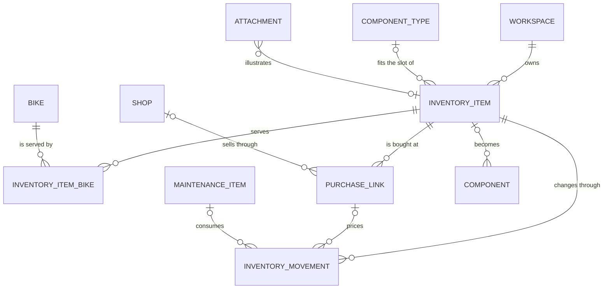
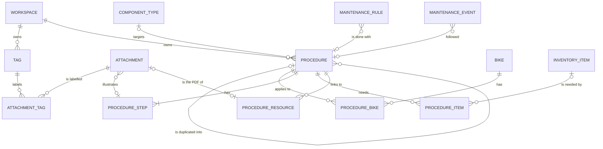

# Data model

Target database: SQLite, with the schema written in Drizzle ORM (see
[04-architecture.md](04-architecture.md#stack)). Types below are logical types;
[Conventions](#conventions) gives the SQLite mapping.

Status: **Proposed**, except where a section says otherwise. Simplifications that follow from
decisions: one user to start with, but users and workspaces modelled from day one (D-25),
components never change bike (D-05), bike park fields (D-06), files stored (D-07). The workshop,
the bike record, the total cost, the phase 1.5 tables (labels, procedures) and the rules that keep
the data readable by an AI were **Decided** on 2026-10-25 (D-33 to D-47, D-50).

## Overview

```mermaid
erDiagram
    WORKSPACE ||--o{ MEMBERSHIP : "has"
    USER ||--o{ MEMBERSHIP : "has"
    WORKSPACE ||--o{ BIKE : "owns"
    WORKSPACE ||--o{ SHOP : "owns"
    WORKSPACE ||--o{ INVENTORY_ITEM : "owns"
    USER |o--o{ MAINTENANCE_EVENT : "created"
    BIKE ||--o{ COMPONENT : "is fitted with"
    BIKE ||--o{ RIDE : "is ridden in"
    BIKE ||--o{ MAINTENANCE_EVENT : "receives"
    BIKE ||--o{ MAINTENANCE_RULE : "has"
    BIKE |o--o{ TASK : "has"
    MAINTENANCE_EVENT ||--|{ MAINTENANCE_ITEM : "contains"
    COMPONENT |o--o{ MAINTENANCE_ITEM : "is concerned by"
    COMPONENT |o--o| COMPONENT : "replaces"
    MAINTENANCE_RULE |o--o{ MAINTENANCE_ITEM : "is reset by"
    SHOP |o--o{ MAINTENANCE_EVENT : "performs"
    COMPONENT_TYPE ||--o{ COMPONENT : "categorises"
    COMPONENT_TYPE |o--o{ MAINTENANCE_RULE : "targets slot"
    COMPONENT_TYPE |o--o{ RULE_TEMPLATE : "suggests"
    RULE_TEMPLATE |o--o{ MAINTENANCE_RULE : "is copied into"
    ATTACHMENT }o--o| BIKE : "illustrates"
    ATTACHMENT }o--o| COMPONENT : "illustrates"
    ATTACHMENT }o--o| MAINTENANCE_EVENT : "proves"
    ATTACHMENT }o--o| RIDE : "documents"
    ATTACHMENT }o--o| TASK : "documents"
    ATTACHMENT }o--o| INVENTORY_ITEM : "illustrates"
    BIKE |o--o| ATTACHMENT : "has as cover"
    INVENTORY_ITEM |o--o| ATTACHMENT : "has as photo"
    INVENTORY_ITEM |o--o{ COMPONENT : "becomes"
```



The workshop's own tables are in [Workshop](#workshop-d-33-to-d-42).

Two ideas carry the model:

1. **Usage is never typed twice.** Kilometres and hours live on rides only. Bike, component and
   rule counters are computed from rides (see [Wear counters](#wear-counters)).
2. **Rules target a slot, not a part.** "Check the chain every 500 km" belongs to the
   *chain slot* of a bike (bike + component type + position). When the chain is replaced, the
   rule stays and its counter restarts.

## Users and workspaces (D-25)

A **workspace** owns the data: a rider's garage today, possibly a shop's workshop one day.
**Users** belong to workspaces through **memberships**. At first launch, a setup screen creates
the first user and their workspace; nothing else exists until multi-user features are needed.

Status: **Decided** (D-25, D-26) and built in Phase 0 (`src/server/db/schema.ts`, migration
`0000_init`).

| Table | Fields | Notes |
|-------|--------|-------|
| `users` | `id` (text), `email` (unique), `name`, `email_verified`, `image`, `created_at`, `updated_at` | Shape required by Better Auth. `id` is a random text id generated by Better Auth, the one exception to integer ids (D-26). Password hashes live in `accounts`, sessions in `sessions` |
| `sessions`, `accounts`, `verifications` | As required by Better Auth | Managed by the auth library only; application code never queries them |
| `workspaces` | `id`, `name`, `created_at` | "My garage" |
| `memberships` | `user_id`, `workspace_id`, `role` (`owner` for now; `member`, `mechanic`… later), `created_at` | Primary key (`user_id`, `workspace_id`). `role` has a CHECK constraint: adding a role needs a migration |

**`workspaces`**, the only table of this section in the ZIP export (feature 12):

| Field | Type | Notes |
|-------|------|-------|
| `id` | integer PK | Referenced by the `workspace_id` of the tables at the top of each hierarchy |
| `name` | text, required | Shown in the app; "Mon garage" in the demo |
| `created_at` | timestamp | Instant, UTC epoch milliseconds |

Scoping rules:

- Tables at the top of the hierarchy carry a `workspace_id`: `bikes`, `shops`, `tasks`,
  `inventory_items`, `tags` and `procedures` (1.5), and the custom `rule_templates`
  (`workspace_id` null = built-in template shared by everyone).
- Link tables between two workspace-owned rows (`inventory_item_bikes`, `attachment_tags`,
  `procedure_bikes`) carry no workspace: the data-access layer checks that both rows belong to
  the current workspace.
- Everything below a bike (components, rides, maintenance, rules, readings, setups)
  inherits the workspace through `bike_id`, so no extra column is needed there. Attachments
  inherit it from their one element (a bike or something below it, a task, a workshop item).
- Per-person data carries a `user_id`: Garmin integration (each person has their own Garmin
  account), notification preferences, sessions.
- `maintenance_events.created_by` records who logged the work (useful for a shop's mechanics).
- Every server-side query goes through one data-access layer that receives the current user
  and workspace. No page or action queries the database directly. This is what makes adding
  real multi-user features later a matter of UI, not a rewrite.

## Core tables

### `bikes`

Status: **Built** in phase 1 feature 1 (2026-10-26, migration `0001_bikes_and_shops`);
`cover_attachment_id` added with the attachments (feature 10, 2026-10-27, migration
`0010_attachments`, D-57).

| Field | Type | Notes |
|-------|------|-------|
| `id` | integer PK | |
| `workspace_id` | FK `workspaces`, required | D-25. Deleting a workspace deletes its bikes (only the dev seed does it) |
| `name` | text, required | "Spectral", "Gravel alu". Unique per workspace, compared without case, accents or extra spaces by the app (D-55); unique index on (`workspace_id`, `name`) as the last line |
| `discipline` | enum, required | See [values](#bike-values) |
| `is_electric` | boolean, required, default `false` | e-MTB, e-gravel… (an e-bike can be any discipline) |
| `brand`, `model` | text | "Canyon", "Spectral 29 CF" |
| `model_year` | integer | Model year given by the maker, 1900–2100 |
| `frame_size` | text | As the maker writes it: "L", "56" |
| `wheel_size` | enum, nullable | See [values](#bike-values) (D-56) |
| `color` | text | |
| `frame_serial` | text | Frame number, for the theft or insurance file. Shown masked except its last group |
| `weight_g` | integer, nullable | Grams, > 0 |
| `purchased_on` | date | Calendar date of the purchase |
| `purchase_price_cents` | integer, nullable | Euro cents, ≥ 0 (Q-08) |
| `purchase_shop_id` | FK `shops`, nullable | Where it was bought; `null` for a private sale or unknown |
| `bought_used` | boolean, required, default `false` | `true`: second-hand |
| `initial_distance_m`, `initial_wear_s` | integer, required, default 0 | Distance (metres) and wear time (seconds) ridden before tracking started (second-hand bike, history not entered); 0 when none. Added to the bike's counters, never to the cost per 100 km (D-44) |
| `status` | enum, required, default `active` | See [values](#bike-values). Bikes are never deleted, only given another status |
| `status_changed_on` | date, nullable | The day the current status began: the sale date for a sold bike, the purchase date (else the creation day) for a new active bike (D-56) |
| `sale_price_cents` | integer, nullable | Euro cents, ≥ 0. Only on a sold bike (CHECK), deducted from the total cost (D-44) |
| `cover_attachment_id` | FK `attachments`, nullable, `ON DELETE SET NULL` | Main photo: a `photo` attached to this bike (D-75); the first one by default. Added with feature 10 by `ALTER TABLE … ADD COLUMN` (D-57) |
| `notes` | text | |
| `created_at`, `updated_at` | timestamp | Instants, UTC epoch milliseconds |

CHECK constraints: the three enums; `sale_price_cents` null unless `status = 'sold'`; prices ≥ 0,
weight > 0, initial distance and wear ≥ 0.

<a id="bike-values"></a>**Values**

| Column | Value | Meaning |
|--------|-------|---------|
| `discipline` | `road` | Road bike |
| | `gravel` | Gravel or all-road bike |
| | `xc` | Cross-country mountain bike |
| | `trail` | Trail mountain bike |
| | `enduro` | Enduro mountain bike |
| | `dh` | Downhill bike |
| | `dirt` | Dirt jump or pump track bike |
| | `city` | City, commuting or touring bike |
| | `other` | Anything else |
| `wheel_size` | `29`, `27.5`, `26` | Both wheels of that diameter, in inches |
| | `mullet` | 29 in front, 27.5 in the rear |
| | `700c`, `650b` | Road and gravel wheel sizes (ETRTO 622 and 584 mm) |
| | `other` | Another size (kids' bikes, fat bikes…) |
| `status` | `active` | Ridden: shown everywhere, its rules run |
| | `stored` | Put away: still shown, offered in the quick ride entry, its distance and hour rules do not move |
| | `sold` | Sold: folded on the list; the sale price is deducted from the total cost |
| | `stolen` | Stolen: folded on the list; its record stays ready for the declaration |
| | `retired` | No longer used: folded on the list; its history stays readable |

The bike record (D-43) needs no other column: identity, purchase and security are these fields,
and the total cost is computed (see [Total cost](#total-cost-d-44)).

### `component_types` (reference data)

Status: **Built** in phase 1 feature 2 (2026-10-26): table in migration `0002_reference_tables`,
rows in the data migration `0003_reference_data` (D-59). Shared by every workspace; a new type
needs a data migration and an entry in `COMPONENT_TYPE_CODES` (`src/lib/enums.ts`).

| Field | Type | Notes |
|-------|------|-------|
| `code` | text PK | English code, see the list below. French labels live in the UI only (D-50, D-59) |
| `component_group` | enum, required | Where the part is shown on the bike page: `suspension`, `drivetrain`, `brakes`, `wheels`, `cockpit`, `frame`, `electric`, `other` (`group` is a reserved SQL word) |
| `has_position` | boolean, required | `true` when the part exists front and rear (tyres, wheels, brakes, pads, rotors) |
| `single_slot` | boolean, required | At most one fitted part per bike and position (checked by the app); `false` for `other` only |

| Code | Group | Position | Meaning |
|------|-------|----------|---------|
| `fork` | suspension | | Suspension or rigid fork |
| `rear_shock` | suspension | | Rear shock |
| `chain` | drivetrain | | Chain |
| `cassette` | drivetrain | | Cassette or freewheel |
| `chainring` | drivetrain | | Chainring(s) |
| `crankset` | drivetrain | | Crank arms |
| `bottom_bracket` | drivetrain | | Bottom bracket bearings |
| `rear_derailleur` | drivetrain | | Rear derailleur |
| `shifter` | drivetrain | | Shift lever |
| `pedals` | drivetrain | | Pedals |
| `brake` | brakes | front/rear | Brake (lever and caliper), the slot of the bleed rule |
| `brake_pads` | brakes | front/rear | Brake pads |
| `rotor` | brakes | front/rear | Brake rotor |
| `wheel` | wheels | front/rear | Wheel (rim, hub, spokes) |
| `tire` | wheels | front/rear | Tyre |
| `hub_bearings` | wheels | front/rear | Hub bearings (added by migration `0009`, D-71) |
| `handlebar` | cockpit | | Handlebar |
| `stem` | cockpit | | Stem |
| `grips` | cockpit | | Grips or bar tape |
| `saddle` | cockpit | | Saddle |
| `dropper_post` | cockpit | | Dropper seatpost |
| `frame` | frame | | Frame |
| `headset` | frame | | Headset |
| `frame_bearings` | frame | | Frame pivot and linkage bearings (added by migration `0009`, D-71) |
| `motor` | electric | | E-bike motor |
| `battery` | electric | | E-bike battery |
| `display` | electric | | E-bike display or remote |
| `other` | other | | Anything else; several can be fitted |

### `rule_templates` (reference data, editable)

Status: **Built** in phase 1 feature 2 (2026-10-26), same migrations (D-59). Default intervals
offered when a component is created. They are only suggestions, to be adjusted to each part's
manual. No editing screen in phase 1: a workspace's own templates come later.

| Field | Type | Notes |
|-------|------|-------|
| `id` | integer PK | |
| `workspace_id` | FK, nullable | `null` = built-in template; otherwise a custom one (D-25) |
| `code` | text, unique, nullable | Stable key of a built-in template, e.g. `chain_wear_check`, so a later migration can correct it. CHECK: set for built-in templates only (D-59) |
| `component_type_code` | FK `component_types`, nullable | `null` = bike-level template (e.g. yearly check) |
| `title` | text, required | "Contrôle d'usure de la chaîne" (shown to the person, so in French) |
| `interval_distance_m`, `interval_wear_s`, `interval_days` | integer, nullable | Metres, seconds of wear time, days. At least one is set, each > 0 (CHECK); whichever comes first |
| `source` | enum, required | `manufacturer`: given by the part's maker; `common_practice`: usual advice, not a maker's figure; `personal`: the owner's own choice |
| `evidence_level` | enum, required | How far the interval can be trusted (D-59): `verified` (checked in the source, with a date in the notes), `secondary` (read in a secondary source), `unverified` (quoted without a checked source), `estimate` (an order of magnitude) |
| `source_url` | text, nullable | Where the number comes from, when there is a page |
| `notes` | text | What to check, in French |
| `created_at`, `updated_at` | timestamp | |

Built-in templates (rows of `0003_reference_data`):

| Code | Slot | Interval | Source · evidence | Basis |
|------|------|----------|-------------------|-------|
| `rockshox_fork_lower_leg_service` | fork | 50 h | manufacturer · secondary | RockShox support page: 50 ride hours for the lower legs, 100/200 h services depending on model year. Read through a search summary because the page blocks direct fetching; re-check in the part's manual |
| `rockshox_rear_shock_air_can_service` | rear_shock | 50 h | manufacturer · secondary | Same source |
| `fox_fork_full_service`, `fox_rear_shock_full_service` | fork, rear_shock | 125 h or 365 days | manufacturer · unverified | Quoted by retailers, others say 100 h. Check the manual |
| `chain_wear_check` | chain | 500 km | common_practice · estimate | Common practice |
| `brake_bleed` | brake | 365 days | common_practice · estimate | Hydraulic brakes |
| `tubeless_sealant_top_up` | tire | 90 days | common_practice · estimate | Tubeless tyres |
| `bike_general_check` | — | 365 days | common_practice · estimate | Whole bike |

### `components`

Status: **Built** in phase 1 feature 3 (2026-10-26, migration `0004_components_and_maintenance`),
except `inventory_item_id`, added with the workshop (feature 8, D-57).

| Field | Type | Notes |
|-------|------|-------|
| `id` | integer PK | |
| `bike_id` | FK `bikes`, required, never changes | D-05. The part inherits the workspace through its bike (D-25) |
| `type_code` | FK `component_types`, required | |
| `position` | enum, required | `front`, `rear` for the types with `has_position`, else `none`. Brakes, pads, rotors, wheels and tyres are recorded per position (D-62) |
| `brand`, `model` | text | "RockShox", "Lyrik Ultimate"; at least one of them (Zod) |
| `reference` | text | Manufacturer part number or SKU |
| `specs` | JSON, nullable | Free key/values, e.g. `{"travel_mm": 160}` (shown after the name: "· 160 mm"). Never filtered or summed (D-50) |
| `origin` | enum, required | See [values](#component-values) |
| `replaces_component_id` | FK `components`, nullable | The part it replaced in the same slot: one history chain per slot. CHECK: never on an `origin = stock` part |
| `installed_at` | timestamp, required | Rides from this instant on count towards its wear. Original part: first millisecond of the bike's purchase day; other parts: see D-61 |
| `initial_distance_m`, `initial_wear_s` | integer, required, default 0 | Usage before it was fitted (second-hand part) or before tracking started; 0 when none |
| `removed_at` | timestamp, nullable | `null` = currently fitted. CHECK: ≥ `installed_at` |
| `removal_reason` | enum, nullable | See [values](#component-values). CHECK: set exactly when `removed_at` is set. Feeds phase 3 |
| `removal_note` | text, nullable | Detail shown after the reason: "chape tordue aux Gets" (D-43). `notes` stays for the part itself |
| `purchased_on` | date, nullable | |
| `purchase_price_cents` | integer, nullable | ≥ 0. Informative: the total cost counts parts through their maintenance lines only (D-44) |
| `shop_id` | FK `shops`, nullable | Where it was bought |
| `inventory_item_id` | FK `inventory_items`, nullable | The workshop item the part came from (D-33). Added with feature 8 |
| `warranty_ends_on` | date, nullable | Last day covered by the warranty |
| `notes` | text | |
| `created_at`, `updated_at` | timestamp | |

<a id="component-values"></a>**Values**

| Column | Value | Meaning |
|--------|-------|---------|
| `position` | `front`, `rear` | Front or rear part of a type that exists on both ends |
| | `none` | A type without position (chain, fork…) |
| `origin` | `stock` | Part of the bike as bought (the original spec) |
| | `replacement` | Fitted to replace a worn, broken or crashed part |
| | `upgrade` | Fitted to improve on the previous part, or added later without replacing anything |
| `removal_reason` | `worn` | Worn out |
| | `broken` | Broken |
| | `crash` | Damaged in a crash |
| | `upgrade` | Replaced by a better part |
| | `sold_with_bike` | Left on the bike when it was sold |
| | `other` | Any other reason, explained in `removal_note` |

**Original spec (D-43):** the components with `origin = stock`, each followed through
`replaces_component_id` down to the part fitted today. The wear at removal is the component's
counter at `removed_at`, computed, not stored (`fittedSlots` in `src/server/domain/components.ts`).
A part's counter unit follows its group: hours for suspension and electric parts, kilometres for
the others.

### `rides`

Status: **Built** in phase 1 feature 4 (2026-10-26, migration `0005_rides`), except
`external_activity_id`, added with the Garmin import (phase 2, D-57). Rides are edited and deleted
from their sheet (D-70); a change of duration clears `moving_time_s`.

| Field | Type | Notes |
|-------|------|-------|
| `id` | integer PK | |
| `bike_id` | FK `bikes`, required | The ride inherits the workspace through its bike (D-25) |
| `started_at` | timestamp, required | Noon local time when only a date was typed, else the time given (D-61) |
| `title` | text, nullable | Not typed in the quick entry: lists show the place, else the ride type |
| `location` | text, nullable | Free text, offered again from previous rides ("Les Gets", "Salève") |
| `ride_type` | enum, required | See [values](#ride-values) |
| `lift_assisted` | boolean, required, default `false` | Lifts or shuttles: wear counts the descent only (D-13). The quick entry sets it for `bike_park` (D-64) |
| `distance_m` | integer, nullable | Total recorded distance, ≥ 0 |
| `descent_distance_m` | integer, nullable | Distance ridden downhill on lift days, ≥ 0 |
| `total_time_s` | integer, nullable | Total time of the ride or of the day (D-06); the quick entry's single duration (D-64). > 0 |
| `moving_time_s` | integer, nullable | Given by Garmin (phase 2); not typed in the quick entry. > 0 |
| `descent_time_s` | integer, nullable | Descent time only (D-06). > 0 and ≤ `total_time_s` (CHECK) |
| `runs_count` | integer, nullable | Number of runs (D-06), ≥ 0 |
| `elevation_gain_m`, `elevation_loss_m` | integer, nullable | ≥ 0 |
| `conditions` | enum, nullable | See [values](#ride-values) |
| `notes` | text | |
| `source` | enum, required, default `manual` | See [values](#ride-values) |
| `external_activity_id` | FK `external_activities`, nullable | Phase 2 (D-57) |
| `created_at`, `updated_at` | timestamp | |

Validation: at least one of `total_time_s` and `moving_time_s` is set (CHECK). Durations are
seconds; the UI types hours and minutes.

<a id="ride-values"></a>**Values**

| Column | Value | Meaning |
|--------|-------|---------|
| `ride_type` | `road`, `gravel`, `xc`, `trail`, `enduro`, `dh` | The discipline ridden (the bike's own discipline is on `bikes`) |
| | `bike_park` | A day with lifts or shuttles (D-06) |
| | `commute` | Riding to work or around town |
| | `indoor` | Home trainer |
| | `other` | Anything else |
| `conditions` | `dry`, `wet`, `mud`, `dust`, `snow` | The ground during the ride |
| | `mixed` | Several of these |
| `source` | `manual` | Typed in the app |
| | `garmin_api`, `file_import` | Imported from Garmin's API or a FIT file (phase 2) |

### `shops`

Status: **Built** in phase 1 feature 1 (2026-10-26, migration `0001_bikes_and_shops`).

Where bikes and parts are bought or serviced. In phase 1 a shop is created by typing a new name
in a bike's purchase (D-55); there is no shop screen yet.

| Field | Type | Notes |
|-------|------|-------|
| `id` | integer PK | |
| `workspace_id` | FK `workspaces`, required | D-25 |
| `kind` | enum, required | `physical`: a shop with an address; `online`: a web shop (D-37) |
| `name` | text, required | Unique per workspace, compared without case, accents or extra spaces by the app (D-55); unique index on (`workspace_id`, `name`) |
| `city`, `phone`, `website`, `notes` | text, nullable | Not entered in phase 1 |
| `created_at`, `updated_at` | timestamp | Instants, UTC epoch milliseconds |

### `maintenance_events`

Status: **Built** in phase 1 feature 3 (2026-10-26, migration `0004`): a replacement records one
(D-63). The entry sheet ("Nouvel entretien", D-63) was built in feature 5: a required title, up to
20 lines (replacements excluded), the total summed from the lines unless typed. "Annuler" deletes
the event and its lines, unless a replacement joined it since (D-60). "Modifier l'entretien" rewrites the
event and its lines except replacements, which follow a new date (`removed_at` of the old part,
`installed_at` of the new one, the stock movement); "Supprimer l'entretien" also undoes its
replacements (D-70).

One visit to the shop or one session in the garage.

| Field | Type | Notes |
|-------|------|-------|
| `id` | integer PK | |
| `bike_id` | FK `bikes`, required | |
| `performed_on` | date, required | The day it was done. Its instant for counters (rule resets) is derived with `created_at`: the moment it was recorded if dated that day, else the end of its day (D-61) |
| `title` | text, required | "Révision avant saison"; a replacement writes "Chaîne remplacée" |
| `performed_by` | enum, required | `self`: done at home; `shop`: done by a shop |
| `shop_id` | FK `shops`, nullable | The shop that did it. CHECK: null unless `performed_by = 'shop'` |
| `created_by` | FK `users`, nullable | Who logged it (D-25); null if that account was deleted |
| `total_cost_cents` | integer, nullable | The total typed (an invoice). `null`: the event costs the sum of its lines' `cost_cents` (D-63). ≥ 0 |
| `notes` | text | |
| `created_at`, `updated_at` | timestamp | `created_at` also dates a same-day event for the counters (D-61) |

### `maintenance_items`

Status: **Built** in phase 1 feature 3 (2026-10-26); `rule_id` added with the rule engine (feature 6,
migration `0006`, D-57).

What was done during an event. A shop service often covers several interventions (chain +
cassette + pads + bleed): each one can reset its own rule and point to its own part.

| Field | Type | Notes |
|-------|------|-------|
| `id` | integer PK | |
| `event_id` | FK `maintenance_events`, required | |
| `action` | enum, required | `replaced`, `serviced`, `inspected`, `adjusted`, `cleaned`, `lubricated`, `bled` (brakes), `trued` (wheel), `other` |
| `component_id` | FK `components`, nullable | The part concerned (for `replaced`: the part removed) |
| `new_component_id` | FK `components`, nullable | For `replaced` only: the part fitted. CHECK: both parts set for `replaced`, no new part otherwise |
| `rule_id` | FK `maintenance_rules`, nullable | This item fulfils the rule, so its counter restarts. Added in feature 6 (migration `0006`); must be a rule of the event's bike |
| `description` | text | |
| `cost_cents` | integer, nullable | ≥ 0. For `replaced`, the price of the part fitted |
| `measurement_value` | real, nullable | E.g. chain stretch 0.5, pad thickness 1.2. Feeds phase 3 |
| `measurement_unit` | enum, nullable | `percent` or `mm` (D-63). CHECK: set exactly when `measurement_value` is |
| `created_at` | timestamp | |

**"Replace a part" flow (one sheet, built in feature 3):** pick the old part, give a removal
reason and its detail and the date (today by default, D-61), then choose the new part from the
workshop first (feature 8; until then "Autre pièce, hors atelier" only): items of the same slot type, serving the bike,
in stock. Choosing one prefills the new part (brand, model, reference, last purchase price,
D-38); "Autre pièce, hors atelier" stays possible, prefilled from the old part. The sheet spells
out the effect on the stock before saving. In one transaction the app sets `removed_at` on the
old part, creates the new one with `replaces_component_id` and `inventory_item_id`, records a
`replaced` item and, for a stock item, a `use` movement of −1 linked to it. Undo removes all
four together (D-60). The line can join an event of the same bike and day instead of creating
one (D-63). Rules on that slot restart if `reset_on_replacement` is set.

### `maintenance_rules` — "what's coming", recurring

Status: **Built** in phase 1 feature 6 (2026-10-26, migration `0006_maintenance_rules`, which also
adds `maintenance_items.rule_id`), except `procedure_id` (phase 1.5). Status, usage, ratio and ETA
are computed by `src/server/domain/rules.ts`, never stored (D-50, D-65).

| Field | Type | Notes |
|-------|------|-------|
| `id` | integer PK | |
| `bike_id` | FK `bikes`, required | The rule inherits the workspace through its bike (D-25) |
| `component_type_code` | FK `component_types`, nullable | The slot's type. `null` = a bike-level rule (yearly check) |
| `position` | enum, nullable | `front` or `rear`: one side; `null`: every part of the type (both brakes), or the bike. CHECK: null for a bike-level rule |
| `template_id` | FK `rule_templates`, nullable | Where the rule came from |
| `title` | text, required | "Entretien des bas de fourreaux (RockShox)" |
| `interval_distance_m`, `interval_wear_s`, `interval_days` | integer, nullable | At least one is set, each > 0 (CHECK); whichever comes first |
| `warn_ratio` | real, required, default `0.9` | "Due soon" from this share of any interval; CHECK between 0 and 1 (the UI offers 50 to 99 %) |
| `reset_on_replacement` | boolean, required, default `true` | Fitting a new part in the slot restarts the counter. Always false for a bike-level rule |
| `counter_start_at` | timestamp, required | Counter start while the rule has never been done: the part's fitting for a rule from a template, the end of the "last done" day typed in the sheet, else the start of tracking |
| `active` | boolean, required, default `true` | `false`: set aside, not shown in "À prévoir"; rules are never deleted |
| `snooze_ends_on` | date, nullable | Snoozed until this date ("Reporter": 14 days): the rule shows its real status again from that day |
| `procedure_id` | FK `procedures`, nullable | Phase 1.5 (D-47) |
| `notes` | text | |
| `created_at`, `updated_at` | timestamp | |

Computed status values: `ok` (ratio < `warn_ratio`), `due_soon` (≥ `warn_ratio`), `overdue` (≥ 1),
`snoozed` (before `snooze_ends_on`).

### `tasks` — "what's coming", one-off

Status: **Built** in phase 1 feature 7 (2026-10-26, migration `0007_tasks`, D-66).

One-off to-dos only (D-34), shown under "À prévoir" after the rules: all of them on the
dashboard, a bike's own on its page. Same row as a rule without the wear bar, a neutral "Tâche"
badge, the due date or "Sans échéance", and "Fait" with undo. Parts to buy live in the workshop
(D-33). A done task moves to the history, placed at `done_at` (D-77): the bike page's history
(its bike's tasks), Activité and the dashboard's recent activity (all of them, general ones
included); it opens "Modifier la tâche", which can reopen it. Cancelled tasks are not shown.

| Field | Type | Notes |
|-------|------|-------|
| `id` | integer PK | |
| `workspace_id` | FK `workspaces`, required | Tasks may have no bike, so they carry the workspace themselves |
| `bike_id` | FK `bikes`, nullable | `null` = general ("check the garage's floor pump") |
| `component_type_code`, `position` | nullable | Optional slot; not offered by the phase 1 sheet |
| `title` | text, required | |
| `due_on` | date, nullable | |
| `status` | enum, required, default `open` | `open`: to do; `done`: done (`done_at` set); `cancelled`: dropped (not offered in phase 1) |
| `priority` | enum, required, default `normal` | `low`, `normal`, `high`; not offered in phase 1 |
| `done_at` | timestamp, nullable | When it was marked done. CHECK: set exactly when `status = 'done'` |
| `notes` | text | |
| `created_at`, `updated_at` | timestamp | |

### `attachments` — photos, invoices, manuals, tracks

Status: **Built** in phase 1 feature 10 (2026-10-27, migration `0010_attachments`, which also adds
`bikes.cover_attachment_id` and `inventory_items.photo_attachment_id` by `ALTER TABLE … ADD
COLUMN`, D-57). Decisions D-45, D-72 to D-76.

| Field | Type | Notes |
|-------|------|-------|
| `id` | integer PK | |
| `bike_id`, `component_id`, `maintenance_event_id`, `ride_id`, `task_id`, `inventory_item_id` | FK, nullable, `ON DELETE CASCADE` | **Exactly one** is set (CHECK constraint, D-45): the element the file belongs to. Its workspace is that element's (D-25). Phase 1.5 adds `procedure_step_id` and `procedure_id` to the same CHECK |
| `kind` | enum: `photo`, `invoice`, `manual`, `track`, `other` | See [values](#attachment-values). Proposed from the file (`photo` for an image, `invoice` for a PDF), changeable (D-74). CHECK: a `photo` is an image |
| `storage_path` | text, unique | Relative to the data directory: `uploads/YYYY/MM/<random>.<ext>` (UTC month of the upload, 32 random hex characters). Never derived from the file name |
| `original_name` | text | The file name sent by the browser, cleaned (no folder, no control character, 200 characters at most). Shown, and used for downloads |
| `mime_type` | text | Detected from the content (magic bytes), never taken from the browser: `image/jpeg`, `image/png`, `image/webp` or `application/pdf` |
| `size_bytes` | integer | Size of the original, in bytes; > 0 and at most 25 MB (26 214 400 bytes) |
| `sha256` | text | Hex SHA-256 of the original, computed while it was received: integrity checks, duplicate detection later |
| `width_px`, `height_px` | integer, nullable | Images only, in pixels, as displayed (EXIF orientation applied); null for a PDF |
| `taken_at` | timestamp, nullable | Images only: EXIF `DateTimeOriginal` with `OffsetTimeOriginal` (without an offset, read in `TZ`); else the file's `lastModified`, sent by the client as its own field (the body does not carry it); else the upload time (H-11). A date before 1990 or in the future is not believed. Editable; without a time, noon. Null for a PDF. Galleries sort on it |
| `caption` | text, nullable | 200 characters at most. Without one, the alternative text is generated from the linked element ("Photo de l'entretien « … »"): nothing more to store |
| `created_at`, `updated_at` | timestamp | Instants, UTC epoch milliseconds: the upload, the last edit |

<a id="attachment-values"></a>**Values of `kind`**

| Value | Meaning |
|-------|---------|
| `photo` | A picture of the element: shown in the galleries, can be a cover (D-75). Images only |
| `invoice` | An invoice or a receipt (PDF, or a photographed one): warranty, total cost proof |
| `manual` | A manual, a technical sheet |
| `track` | A ride file (FIT, GPX): phase 2, not offered yet |
| `other` | Any other document (warranty certificate, insurance…) |

Files live on disk, never in the database. The original is kept byte for byte, EXIF and GPS
included (D-72); the position is never stored in a column. Derived copies (WebP, EXIF
orientation applied, **no metadata**) go to `cache/<storage path without extension>/`
(`thumb.webp`, 320 px square; `display.webp`, 1600 px inside): they are regenerated on demand, so
they are left out of the backups.

Accepted formats (D-73): JPEG, PNG and WebP for photos, PDF for documents. HEIC is refused with
its own message; everything else as an unsupported format. Type checked from the content, 25 MB
per file checked while it streams, one upload request per file so each shows its own progress.

Deleting the element deletes its rows (cascade) and the data-access layer deletes their files
after the transaction (D-76). Workshop items are archived, never deleted (D-67): their
attachments stay. Bikes are never deleted (Q-12).

### Workshop (D-33 to D-42)

The garage's inventory, owned by the workspace. Created complete in phase 1; the phase 1 UI
offers parts only, products and tools come in 1.5 (D-33).

Status: **Built** in phase 1 feature 8 (2026-10-26, migration `0008_workshop`, which also adds
`components.inventory_item_id`); `inventory_items.photo_attachment_id` added with the
attachments (feature 10, 2026-10-27, D-57). CHECK constraints: a part has a unit and only a part does; a
restocking quantity only while to order or ordered (> 0); a link names a shop or a page; the sign
of each movement kind (below); prices and thresholds ≥ 0. Values of `kind`: `part` (counted in
units), `product` (levels and containers, 1.5), `tool` (owned or not, 1.5); of `unit`: `piece`,
`pair`, `set` (a kit); of `restock_status`: `none`, `to_order`, `ordered`; of `level_after`: `full`,
`started`, `low`, `empty`; of movement `kind`: `initial` (stock when the item was added), `purchase`,
`use`, `adjustment` (a correction after a count).

| Kind | Tracked as | "Stock bas" when |
|------|------------|------------------|
| Part | Exact quantity and a unit (piece, pair, set) | Quantity ≤ the item's alert level |
| Product (1.5) | Level of the open container (full, started, low, empty) and the number of containers (D-36) | The last container is low, or none is left |
| Tool (1.5) | Owned or not | Never; a tool not owned can be put on the "to buy" list |



**`inventory_items`**

| Field | Type | Notes |
|-------|------|-------|
| `id` | integer PK | |
| `workspace_id` | FK `workspaces`, required | Top of its hierarchy (D-25) |
| `kind` | enum: `part`, `product`, `tool` | All three from phase 1 (D-33) |
| `name` | text, required | |
| `brand`, `reference` | text | `reference`: the manufacturer's part number |
| `category` | enum: `suspension`, `drivetrain`, `brakes`, `wheels`, `cockpit`, `frame`, `electric`, `care`, `other` | The component groups, plus `care` (cleaning, lubrication) |
| `component_type_code` | FK `component_types`, nullable | The slot type it fits or serves: feeds the stock picker of "replace a part" and the rules shown on the item |
| `all_bikes` | boolean | `true`: every bike of the workspace, future ones included; `inventory_item_bikes` is then empty |
| `unit` | enum: `piece`, `pair`, `set`, nullable | Parts only |
| `low_stock_threshold` | integer, nullable | Parts only, in the item's `unit`: "Stock bas" at or below it. A suggestion, never an order by itself (D-35) |
| `container_label` | text, nullable | Products only: "flacon", "tube", "bidon" |
| `restock_status` | enum: `none`, `to_order`, `ordered` | Received is an event (a purchase movement), not a status |
| `restock_quantity` | integer, nullable | Set when ordering; prefilled at reception and correctable, then added to the stock (D-42) |
| `restock_changed_on` | date, nullable | Shown on the restocking steps |
| `location` | text | Storage place, free text |
| `photo_attachment_id` | FK `attachments`, nullable, `ON DELETE SET NULL` | Its photo: a `photo` attached to this item, whatever its `kind` (D-75); the first one by default. Added with feature 10 (migration `0010_attachments`) |
| `notes` | text | |
| `archived_at` | timestamp, nullable | Items are archived, not deleted, like bikes and components |
| `created_at`, `updated_at` | timestamp | |

No quantity is stored (D-39): the quantity of a part or tool, and the container count of a
product, are the sum of its movements; a product's level is the `level_after` of its latest
movement that sets one.

**`inventory_item_bikes`**: the bikes an item serves when `all_bikes` is `false`.

| Field | Type | Notes |
|-------|------|-------|
| `item_id` | FK `inventory_items`, required | Primary key on (`item_id`, `bike_id`) |
| `bike_id` | FK `bikes`, required | A bike of the same workspace (checked by the data-access layer) |

**`inventory_movements`**

| Field | Type | Notes |
|-------|------|-------|
| `id` | integer PK | |
| `item_id` | FK `inventory_items`, required | |
| `occurred_at` | timestamp | |
| `kind` | enum: `initial`, `purchase`, `use`, `adjustment` | CHECK: `purchase` > 0, `use` ≤ 0, `initial` ≥ 0 |
| `quantity_delta` | integer, signed | Parts: units. Products: containers (0 when only the level changes). Tools: +1 or −1 |
| `level_after` | enum: `full`, `started`, `low`, `empty`, nullable | Products only |
| `unit_cost_cents` | integer, nullable | Purchases |
| `purchase_link_id` | FK `purchase_links`, nullable | Where it was bought |
| `maintenance_item_id` | FK `maintenance_items`, nullable | The intervention that used it |
| `created_by` | FK `users` | Who recorded it (D-25) |
| `note` | text | |
| `created_at` | timestamp | When it was recorded; `occurred_at` is when it happened |

Stock moves by movements, never by a typed total: "−" records a use, "+" a purchase, and
"Corriger le stock" after a count records the difference as an `adjustment`. Tools are not
recorded per job (D-40).

**`purchase_links`**

| Field | Type | Notes |
|-------|------|-------|
| `id` | integer PK | |
| `item_id` | FK `inventory_items`, required | |
| `shop_id` | FK `shops`, nullable | Physical and online shops alike (D-37) |
| `url` | text, nullable | `null`: bought in a shop, no page. Displayed and opened in a new tab (`rel="noopener noreferrer"`), never fetched (D-09) |
| `price_cents` | integer, nullable | Typed by hand |
| `price_noted_on` | date, nullable | |
| `sort_order` | integer | Display order |
| `notes` | text | |
| `created_at`, `updated_at` | timestamp | |

The last purchase date and the last price paid come from the movements, not from the link. A
part taken from stock costs its last purchase price (D-38).

**Rules meet items through the slot type:** an item with a component type serves the rules of
that slot on its bikes. "À racheter" (dashboard and workshop) lists, most urgent first (D-41):
items needed by a late or due-soon rule, then `to_order`, `ordered`, and low stock not ordered yet.

**Flows**

1. *Replace a part from stock*: see [`maintenance_items`](#maintenance_items).
2. *Received*: the quantity received is confirmed (prefilled with `restock_quantity`), then a
   `purchase` movement of that quantity (cost from the link or typed), then `restock_status`
   back to `none`.
3. *Bleed with mineral oil* (1.5): a `bled` maintenance item plus a movement on the product, with
   `level_after` (delta 0, or −1 when the container is finished).

### `readings` — e-bike values read from the motor system (D-19)

Bosch exposes no public API, so values are typed by hand from the eBike Flow app or the
display, a few times a season. Trends (battery capacity over time, cycles per 1,000 km) come
from these readings.

| Field | Type | Notes |
|-------|------|-------|
| `id` | integer PK | |
| `bike_id` | FK `bikes` | |
| `component_id` | FK `components`, nullable | The battery or motor concerned |
| `read_on` | date | |
| `kind` | enum: `odometer`, `motor_hours`, `charge_cycles`, `battery_capacity_percent`, `firmware_version` | |
| `value_number` | real, nullable | Unit given by `kind`: kilometres for `odometer`, hours for `motor_hours`, a count for `charge_cycles`, percent for `battery_capacity_percent` |
| `value_text` | text, nullable | Firmware version |
| `source` | enum: `manual`, `import` | `import` kept for a future official access |
| `notes` | text | |

### `setups` — suspension and tyre setup log (D-24)

One row per change; the latest row of a bike is its current setup. Per bike, not per ride.

| Field | Type | Notes |
|-------|------|-------|
| `id` | integer PK | |
| `bike_id` | FK `bikes` | |
| `set_on` | date | |
| `fork_pressure_psi`, `shock_pressure_psi` | real, nullable | |
| `fork_rebound_clicks`, `fork_low_speed_compression_clicks`, `fork_high_speed_compression_clicks` | integer, nullable | Counted from fully closed (convention shown in the UI) |
| `shock_rebound_clicks`, `shock_low_speed_compression_clicks`, `shock_high_speed_compression_clicks` | integer, nullable | |
| `fork_volume_spacers`, `shock_volume_spacers` | integer, nullable | Number of volume spacers ("tokens") |
| `sag_front_percent`, `sag_rear_percent` | real, nullable | |
| `tire_front_bar`, `tire_rear_bar` | real, nullable | |
| `extra` | JSON | Anything else (coil spring rate, inserts…) |
| `label` | text | E.g. "bike park", "winter" |
| `notes` | text | Why it changed, how it felt |

### Technical tables

| Table | Purpose |
|-------|---------|
| Auth library tables | `sessions`, `accounts`, `verifications`, managed by Better Auth (see [Users and workspaces](#users-and-workspaces-d-25)), linked to `users` |
| `app_settings` | Key/value settings per workspace (JSON values) |
| `user_settings` | Per-user preferences: notification channel, Telegram chat ID |
| `notifications_log` | Phase 1.5: what was sent to whom, when and through which channel, so nothing is sent twice |

## Phase 1.5 additions (labels, maintenance procedures)

**Decided** on 2026-10-25 (D-45, D-47) and documented now so phase 1 closes no door; the tables
are created in phase 1.5.



### Labels (photos only, D-45)

**`tags`**

| Field | Type | Notes |
|-------|------|-------|
| `id` | integer PK | |
| `workspace_id` | FK `workspaces`, required | Labels are shared by the workspace (D-25) |
| `name` | text, required | As first typed: "numéro de série" |
| `name_key` | text, required | `name` trimmed, lower-cased, accents removed, spaces collapsed; **unique per workspace**. Computed by the app, not by a collation, so it works the same on SQLite and PostgreSQL |
| `created_at` | timestamp | |

**`attachment_tags`**: `attachment_id`, `tag_id`, primary key on both. Deleting a label removes
its links; renaming keeps them. Labels apply to photos only; another link table can be added
later without changing `tags`.

### Maintenance procedures (D-47)

Reusable how-tos written by the owner, distinct from the maintenance events they produce. No
procedure ships with the app: the examples are demo data.

**`procedures`**

| Field | Type | Notes |
|-------|------|-------|
| `id` | integer PK | |
| `workspace_id` | FK `workspaces`, required | |
| `title` | text, required | |
| `description` | text | |
| `component_type_code` | FK `component_types`, nullable | The kind of part it is about |
| `model_hint` | text | Free text, "SRAM Maven": shown and searched, not matched against components |
| `all_bikes` | boolean | `true`: every bike, future ones included; `procedure_bikes` is then empty |
| `estimated_duration_s` | integer, nullable | Seconds, like every duration; the UI shows minutes |
| `difficulty` | enum: `easy`, `medium`, `hard` | |
| `duplicated_from_id` | FK `procedures`, nullable | "Dupliquée de …" |
| `archived_at` | timestamp, nullable | Archived, not deleted: past events keep their link |
| `created_at`, `updated_at` | timestamp | |

**`procedure_bikes`**: `procedure_id`, `bike_id`, primary key on both.

**`procedure_steps`**

| Field | Type | Notes |
|-------|------|-------|
| `id` | integer PK | |
| `procedure_id` | FK, required | |
| `sort_order` | integer | Rewritten on reorder |
| `instruction` | text, required | |
| `note` | text | |
| `torque_nm` | real, nullable | Like `measurement_value`: torques have decimals (6.8 N·m) |

**`procedure_items`**

| Field | Type | Notes |
|-------|------|-------|
| `id` | integer PK | |
| `procedure_id` | FK, required | |
| `inventory_item_id` | FK `inventory_items`, nullable | A given tool, part or product of the workshop |
| `component_type_code` | FK, nullable | Or "a part of this type for the chosen bike": resolved at run time among the workshop's parts of that slot type serving the bike |
| `label` | text, nullable | Or something not in the workshop yet ("Huile de fourche 15 WT"), with "Ajouter à l'atelier" |
| `quantity` | integer, nullable | Parts: units used per job |
| `sort_order` | integer | Display order |

CHECK: exactly one of `inventory_item_id`, `component_type_code`, `label`.

**`procedure_resources`**

| Field | Type | Notes |
|-------|------|-------|
| `id` | integer PK | |
| `procedure_id` | FK, required | |
| `kind` | enum: `video`, `pdf`, `link`, `note` | |
| `url` | text, nullable | Video and link. A link card opened in a new tab, never an embedded player, never fetched (D-09, D-47) |
| `title` | text | Typed by hand |
| `duration_s` | integer, nullable | Videos, typed by hand |
| `attachment_id` | FK `attachments`, nullable | PDF |
| `body` | text, nullable | Note |
| `sort_order` | integer | Display order |

**Columns added to existing tables in 1.5**

- `attachments`: `procedure_step_id` (reference photo of a step) and `procedure_id` (PDF manual),
  inside the "exactly one" CHECK.
- `maintenance_rules.procedure_id`: FK, nullable. The procedure "C'est fait" offers to run, on
  due-soon and overdue rules only.
- `maintenance_events.procedure_id`: FK, nullable, the procedure followed; and `labor_time_s`:
  integer, nullable, the time spent (typed, or timed by workshop mode).

Readiness ("Possédé", "Stock bas", "Manquant"…) is computed from the workshop: nothing about
availability is stored.

**Flow: save a workshop-mode run**, in one transaction: a `maintenance_events` row
(`performed_by = self`, `procedure_id`, `total_cost_cents`, `labor_time_s`); one
`maintenance_items` row per line of the procedure, with `rule_id` when the procedure points to a
rule, which restarts it; `inventory_movements` for the parts used (`use`) and the product levels
(`level_after`, one level down by default), linked to those items; the photos taken as
attachments of the event. Undo removes all of it. Until it is saved, a run in progress lives in
the browser's `localStorage`, not in the database.

## Phase 2 additions (Garmin)

| Table | Purpose |
|-------|---------|
| `integrations` | One row per user and provider (`user_id`, `provider`): `status`, `key_expires_on`, `last_sync_at`, `sync_cursor`, `last_error`. The API key itself stays a secret in the environment, not in the database (**Proposed**) |
| `external_activities` | The inbox of imported activities: `provider`, `external_id` (unique per provider), `started_at`, `activity_type`, `device_name`, distance and times, `summary_json`, `fit_attachment_id`, `suggested_bike_id`, `status` (`new`, `assigned`, `ignored`), `ride_id` |
| `bike_assignment_rules` | Rules that suggest a bike: `field` (`activity_type`, `device`, `gear_id`…), `value`, `bike_id`, `priority`, `trusted` (assign without asking) |

Flow: sync → `external_activities` → a rule suggests a bike → the user confirms (or it is assigned
directly if the rule is trusted) → a ride is created with `source = garmin_api`. Bike park
values are derived from the FIT file (laps or descent detection, see
[06-integrations.md](06-integrations.md#bike-park-on-garmin)).

Duplicates: `(provider, external_id)` is unique. A manual ride on the same bike starting within
±30 minutes of an imported activity is offered for merging.

## Phase 3 additions (AI)

| Table | Purpose |
|-------|---------|
| `spec_suggestions` | Spec sheets proposed by the assistant: `bike_id`, `payload` (JSON), `sources` (JSON), `model`, `status` (`pending`, `accepted`, `rejected`) |
| `predictions` | `rule_id`, `predicted_due_on`, predicted distance/wear, `confidence`, `explanation`, `model_version` |

Manuals are `attachments` of kind `manual`.

## Wear counters

Each ride gives two derived values (computed, not stored):

```text
wear_time_s =
    descent_time_s    if lift_assisted and descent_time_s is set
    moving_time_s     otherwise, if set
    total_time_s      otherwise

wear_distance_m =
    descent_distance_m  if lift_assisted and descent_distance_m is set
    distance_m          otherwise
```

Why (**Decided**, D-13): time spent on a chairlift does not wear a fork. When descent values
are missing, falling back to the larger value is conservative: the reminder comes early, never
late.

> ⚠ On lift days, the distance recorded by a Garmin may include the ride up the lift if
> recording keeps running (**Unverified**, depends on the device and profile). Phase 2 should
> compute descent-only values from the FIT laps or streams.

Counters:

- **Bike**: `bike.initial_*` + the sum over all rides of the bike.
- **Component**: `component.initial_*` + the sum over its bike's rides with
  `installed_at ≤ started_at < removed_at`. Timestamps rather than dates, so a part fitted at
  18:00 does not count that morning's ride. A ride entered without a time starts at noon; a
  replacement dated in the past happens at the end of its day, so that day's rides stay on the
  old part (D-61).
- **Rule status**:
  - *last reset* = the latest of: the last `maintenance_item` linked to the rule; the
    installation of the slot's current part (if `reset_on_replacement`); `counter_start_at`.
  - *usage since reset* = wear distance and wear time of the bike's rides since then, plus the
    days elapsed.
  - *ratio* = the highest of `distance / interval_distance`, `time / interval_wear`,
    `days / interval_days`.
  - *status* = `ok` (ratio < `warn_ratio`), `due_soon` (≥ `warn_ratio`), `overdue` (≥ 1), or
    `snoozed`.
  - *ETA* = what remains, divided by the average daily usage over the last 8 weeks. Shown as
    "≈ in 3 weeks". A simple linear projection, its quality is an **Estimate**.

### Worked example

Enduro bike, stock RockShox fork, rule "Lower leg service — 50 h", warn at 90 %. Last done on
2026-05-10. Rides since then:

| Rides | Wear counted |
|-------|--------------|
| 2026-06-14, Les Gets, bike park: total 6 h 00, descent 2 h 10, 14 runs | 2 h 10 |
| 10 trail rides, 2 h 30 moving time each | 25 h 00 |
| 3 bike park days with no descent time entered, total 6 h each | 18 h 00 (conservative fallback) |
| **Total** | **45 h 10 → 90 % → due soon** |

With about 4 h 30 of riding a week over the last 8 weeks, the ETA is about one week. Had the
descent times of the three bike park days been entered (about 2 h each), the total would be
33 h 10 (66 %): the descent time field matters.

Every figure the wear engine returns comes with the rides and the reset it was computed from:
"Voir le détail" shows them in phase 1 (principle 2 in [01](01-vision-and-scope.md#principles)),
and phase 3 reuses them for its "Why?" panel.

## Total cost (D-44)

Computed, never stored. Shown on the bike record in phase 1.

```text
upkeep_cents = sum of total_cost_cents of the bike's maintenance events
               (shop visits: labour and parts; at home: parts, a stock part at its last
               purchase price, D-38)
total_cents  = purchase_price_cents + upkeep_cents − sale_price_cents (if sold)

per_100_km           = total_cents  / ridden_distance_m × 100 000
per_100_km_upkeep    = upkeep_cents / ridden_distance_m × 100 000
```

- `ridden_distance_m` is the sum of `distance_m` over the bike's rides: usage since tracking
  started, without `initial_distance_m` (that distance was ridden before the costs counted here).
  Per 100 km is not shown until the bike has rides.
- Parts are counted through the maintenance events only, never again through
  `components.purchase_price_cents`, so a part fitted at home is not counted twice.
- Tools and stock not fitted yet do not count: they serve every bike.
- Missing prices count as zero.

## Readable by an AI (D-50)

Phase 3 lets a model read this data (D-49), and the ZIP export is meant to be readable without
the app. The data therefore has to explain itself. **Decided** on 2026-10-25.

1. **Names say what and in which unit.** `distance_m`, `wear_s`, `price_cents`, `torque_nm`;
   `*_on` for calendar dates, `*_at` for instants. No abbreviation that needs the code to decode.
2. **Enums are English text values with a CHECK constraint**, each value defined in this
   document. French labels exist only in the UI.
3. **One meaning per column.** No column reused for another purpose, no magic values (`-1`,
   `0` meaning "unknown"): unknown is `null`. JSON only for free key/values (`components.specs`,
   `setups.extra`), never for something that is filtered or summed.
4. **Clean on the way in.** Every write goes through a Zod schema in the Server Action or Route
   Handler: required fields, ranges (no negative distance), trimmed text, normalised dates and
   units. The database CHECK constraints are the last line, not the only one.
5. **Derived values are computed, never stored**: wear counters, rule status, ETA, stock
   quantities, total cost. They come from the pure domain functions in `src/server/domain`, with
   the rides and events they are based on (principle 2).
6. **This document is the data dictionary.** Every table and column of `src/server/db/schema.ts`
   is described here, and the schema carries a short comment on each table and on every column
   whose meaning is not obvious from its name. A schema change updates both in the same commit.
7. **The export ships the dictionary**: the ZIP contains, next to the CSV/JSON files, a
   machine-readable description of every table and column (type, unit, allowed values, meaning).
   Built in feature 12 (D-68): `dictionary.json` takes the structure from the schema and the
   type and notes from the "Field | Type | Notes" tables of this document, so **every exported
   column must have a row in one of them** (a test checks it); `data-model.md` is this file.
8. **Fictitious data stays realistic and consistent** (D-22): seed and demo data obey the same
   rules, so they can be used to test what a model reads.

## Conventions

- **IDs**: integer primary keys (no sync between devices), except `users.id`, a text id
  generated by the auth library (D-26). If the app ever becomes a hosted service, switching to
  non-guessable IDs (UUIDv7) for URLs is worth considering.
- **Portability**: avoid SQLite-only SQL in queries, so a move to PostgreSQL stays a Drizzle
  configuration change plus a data migration.
- **Units**: distances in metres, durations in seconds, money in euro cents, all as integers.
  The UI converts.
- **Time**: instants (`*_at`) stored in UTC as epoch milliseconds (integer) and displayed in
  the configured `TZ`; calendar dates (`*_on`) stored as `YYYY-MM-DD`.
- **Defaults**: computed by the application (Drizzle `$defaultFn`), not by SQLite-only SQL.
- **Enums**: text columns with CHECK constraints.
- **Deletion**: bikes and components are retired (`status`, `removed_at`), not deleted. Hard
  deletes only fix mistakes ("Annuler", "Supprimer la sortie", "Supprimer l'entretien", D-60,
  D-70), and cascade to attachments, whose files the data-access layer deletes after the
  transaction (D-76).
- **Export**: every table can be exported to CSV/JSON in a single ZIP with the uploads (the
  originals, under `uploads/` at their `storage_path`, feature 10), the
  workshop tables included (and the label and procedure tables from 1.5). It doubles as a
  portable backup. Built in feature 12 (D-68): the auth tables and `memberships` are left out; a
  new table must be added to the export or to its exclusion list (a test checks it).
