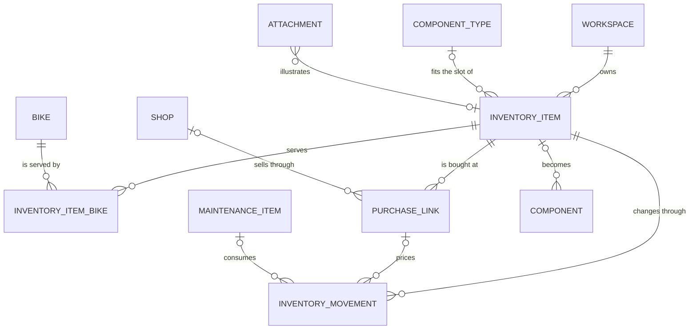
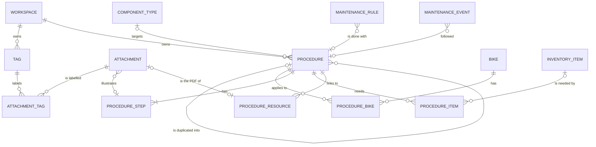

# Design

Status: **Proposed** (2026-10-25), awaiting validation. Once validated, the choices below go into
the decision log ([02](../02-decisions-and-questions.md)) and this status changes.

## Mockups

[`mockups.html`](mockups.html) is one static page. Open it in a browser; it needs an Internet
connection for the fonts and icons. The controls at the top switch:

- the screen: dashboard, bike page, workshop ("Atelier", see
  [Workshop and inventory](#workshop-and-inventory-proposed)), maintenance procedures and photos
  across all bikes (see
  [Bike record, original spec, photo labels and maintenance procedures](#bike-record-original-spec-photo-labels-and-maintenance-procedures-proposed)),
  quick ride entry, phase 3 preview, design foundation;
- the frame: auto (follows the window), iPhone, tablet, PC;
- the theme: system, light, dark.

All data is fictitious (D-22). The Foundation screen measures the contrast of every text and
background pair live, in the theme shown.

To try it on a phone, serve this folder on the local network, then open
`http://<computer-address>:8000/mockups.html` on the phone:

```bash
python3 -m http.server 8000 --directory docs/design
```

This file is a reference for validation, not code to maintain. At step A of phase 1 the same
screens are rebuilt in the app, with the real components and fixture data, on a
development-only `/design` route. This file is then deleted (git history keeps it), so the
design has a single source of truth.

**Why HTML rather than draw.io:** the mockup shows real behaviour (responsive layout, dark mode,
touch sizes, the quick-entry sheet) and opens on a phone. draw.io suits flows and architecture
diagrams; these docs already use Mermaid for that, which GitHub renders.

## Direction

| Topic | Proposal |
|-------|----------|
| Accent | Turquoise, like anodised parts (OKLCH hue 205 in light mode, 195 in dark mode). It stays away from the green, amber and red used for wear status, so a button never looks like an alert |
| Neutrals | Slightly blue greys. Light: tinted page, white cards. Dark: near-black page, lighter surfaces instead of shadows |
| Wear status | Up to date (green), due soon (amber), overdue (red), always with an icon and a label. Wear bars show a tick at the warning threshold (90 %) and are hatched beyond 100 %, so status never relies on colour alone |
| Type | Geist for the interface, Barlow Semi Condensed for figures (km, hours, counters) |
| Layout | Mobile first. Under 700 px: bottom tab bar with a central "+" for quick entry. 700–1023 px: icon rail. From 1024 px: full sidebar |
| Navigation | Accueil · Vélos · + · Activité · Atelier; settings and account from the avatar. Activité holds the ride and maintenance log, then statistics (1.5) and analyses (phase 3). Atelier (proposed, it replaces "Tâches") holds the inventory, see [below](#workshop-and-inventory-proposed); one-off tasks join the rules under "À prévoir" |
| States | Empty states that point to the next action, skeletons while loading, a toast after each action (with undo where possible), validation errors under the field |
| Touch | Controls 44–48 px high on touch screens. Inputs use 16 px text at least, or iOS zooms in on focus |
| Motion | 160–280 ms transitions on hover, press and sheets; switched off when the system asks for reduced motion |
| Accessibility | AA contrast on every text/background pair in both themes, visible keyboard focus, a label on every field |

## Quick ride entry

Required: bike, date, one duration (principle 1 in [01](../01-vision-and-scope.md)). Defaults:
the last bike used, today, and the ride type most often used with that bike. Choosing "Bike park"
shows total time, descent time and number of runs, with the D-13 rule in one sentence. Ride
conditions are one optional row of chips on the main form, because phase 3 needs them
([07](../07-ai.md): data to capture from day one).

## Certainty levels (phase 3)

AI comes in phase 3 ([07](../07-ai.md)). How it is shown is fixed now, so phase 1 screens leave
room for it and never mix facts with guesses:

| Level | Comes from | How it looks |
|-------|------------|--------------|
| Computed | Rules and counters (L0) | Plain display |
| Estimated | Projections and statistics (L1–L3) | "≈", an "Estimation" badge and a "Why?" panel listing the data used |
| Suggested | A language model (L4, spec retrieval, questions) | Dashed frame, sparkles icon, "to review". Nothing is saved without approval; spec lines show their source, and lines without one are flagged |

Consequences for phase 1, without building any AI:

- The wear engine (step B) returns its figures together with the rides and rules they come from.
  The "Voir le détail" link needs it now; the "Why?" panel and an LLM's context reuse it later.
- Data-access functions stay scoped by user and workspace (D-25), so they can later be exposed
  to a model as read-only tools without leaking another workspace's data.

## Workshop and inventory (proposed)

Status: **Proposed** (2026-10-25), shown on the mockup's "Atelier" screen and awaiting
validation. Nothing here is in [02](../02-decisions-and-questions.md) or
[03](../03-data-model.md) yet: once validated, the decisions go to 02 and the tables to 03.

### Concept

The workshop is the garage's inventory, owned by the workspace (D-25). Each item is tracked the
way it is actually used:

| Kind | Tracked as | Examples | "Stock bas" when |
|------|------------|----------|------------------|
| Part | Exact quantity and a unit (piece, pair, set) | Brake pads, chain, seal kit, inner tube | Quantity ≤ the item's alert level |
| Product | Level of the open container (full, started, nearly empty, empty) and the number of containers | Grease, brake fluid (DOT or mineral oil), tubeless sealant, fork oil | The last container is nearly empty, or none is left |
| Tool | Owned or not | Torque wrench, bleed kit, chain tool | Never; a tool not owned can be put on the "to buy" list |

Every item has a name, brand, reference, category (the component groups of the bike page, plus
"care" and "general"), a storage place (free text), an optional photo, notes and any number of
purchase links (shop, address, price, last purchase). It serves no bike, some bikes, or all bikes
(future bikes included).

Rules the mockup follows:

- **Stock moves by movements, never by a typed total.** "−" on the item page records a use, "+"
  a purchase; after a count, "Corriger le stock" records the difference as an adjustment. Each
  change shows a toast with undo.
- **Restocking replaces "parts to order".** An item goes `to_order` → `ordered` → received;
  the quantity is set when ordering and confirmed at reception, which records a purchase and
  adds to the stock. Low-stock items also show up in "À
  racheter" by themselves, in a "Stock bas · pas encore prévu" group, without being ordered.
- **Purchase links are displayed only.** Prices are typed by hand, and the app never fetches a
  shop page (private network, D-09). In the app, links open in a new tab with
  `rel="noopener noreferrer"`.
- **Replacing a part starts from the stock.** The sheet lists the items of the same slot type,
  linked to the bike and in stock; choosing one decrements the stock and prefills the new
  component (brand, model, reference, last purchase price). "Autre pièce, hors atelier" stays
  possible.
- **Items meet rules through the slot type.** An item with a component type serves the rules of
  that slot on its bikes: the sealant lists "Ajout de liquide préventif" on the Spectral, and that
  rule's row shows "Préventif : vide · à commander".
- **Colour.** Restocking states use the accent and the neutrals only, each with its own icon and
  label: "À commander" (outline), "En commande" (accent), "Stock bas" (neutral). Green, amber and
  red stay reserved for wear; inside the workshop they only appear on the badges of the rules an
  item serves.

### Navigation and screens

| Place | What the mockup shows |
|-------|-----------------------|
| Navigation | "Tâches" becomes "Atelier" (lucide `warehouse`) in the bottom bar, the rail and the sidebar |
| Tasks | Out of the workshop: one-off tasks sit under "À prévoir", on the dashboard (all of them) and on the bike page (that bike's), after the rules. Same row as a rule without the wear bar, a neutral "Tâche" badge, the due date or "Sans échéance", and a "Fait" button with undo |
| Atelier | One summary line ("2 en stock bas · 1 en commande · 3 à commander") that leads to "À racheter", then filter chips: Pièces · Produits · Outils · À racheter, with counts. Search (name, brand, reference, category, storage place) and a bike filter. Rows are grouped by category (by status in "À racheter"): thumbnail (photo, else the category icon), name, bike pastilles with the bike names, quantity, level or possession, and at most one badge |
| Item page | Stock with −/+ and the alert level, or level and containers, or possession; restocking steps; bikes; purchase links with the cheapest one marked; maintenance concerned (rules of the slot, last use); movement history linking to the maintenance event; notes. Under 1024 px it replaces the list, with "‹ Atelier" in the top bar; from 1024 px the list and the item sit side by side, and the item stays in view while the list scrolls |
| Add sheet | The type comes first (three cards), then a short form for that type; storage place, photo, purchase link and notes are folded away. Bikes are chosen with chips, "Tous les vélos" being exclusive |
| Dashboard | "À racheter" (formerly "Pièces à commander") lists everything to rebuy, parts, products and tools, the most urgent first: an item needed by a late or due-soon rule ("nécessaire le 1er novembre"), then to order, ordered, low stock. Five rows and "Tout voir (6)". The sealant rule shows its stock line |
| Bike page | "En stock pour ce vélo" (in the "Composants" tab on phones): what is on the shelf for that bike, alerts first, the storage place on each row, and the number of items to rebuy |
| Replace a part | A sketch of the sheet: part removed, reason, part fitted chosen from the workshop first, the effect on the stock spelled out before saving |
| States | Guided empty workshop (suggestions open the add sheet prefilled), item without a purchase link, empty product, no match, nothing to rebuy |

### Data model (Proposed)



**`inventory_items`**

| Field | Type | Notes |
|-------|------|-------|
| `id` | integer PK | |
| `workspace_id` | FK `workspaces`, required | Top of its hierarchy, so it carries the workspace (D-25) |
| `kind` | enum: `part`, `product`, `tool` | |
| `name` | text, required | |
| `brand`, `reference` | text | `reference`: the manufacturer's part number |
| `category` | enum: `suspension`, `drivetrain`, `brakes`, `wheels`, `cockpit`, `frame`, `electric`, `care`, `other` | The component groups, plus `care` (cleaning, lubrication) |
| `component_type_code` | FK `component_types`, nullable | The slot type it fits or serves: feeds the stock picker of "replace a part" and the rules shown on the item |
| `all_bikes` | boolean | `true`: every bike of the workspace, future ones included; `inventory_item_bikes` is then empty |
| `unit` | enum: `piece`, `pair`, `set`, nullable | Parts only |
| `low_stock_at` | integer, nullable | Parts only: "Stock bas" when the quantity is at or below it |
| `container_label` | text, nullable | Products only: "flacon", "tube", "bidon" |
| `restock_status` | enum: `none`, `to_order`, `ordered` | Received is an event (a purchase movement), not a status |
| `restock_quantity` | integer, nullable | Set when ordering; at reception it is prefilled and can be corrected (partial delivery), then added to the stock |
| `restock_changed_on` | date | Shown on the restocking steps |
| `location` | text | Storage place, free text |
| `photo_attachment_id` | FK `attachments`, nullable | Like `bikes.cover_attachment_id` |
| `notes` | text | |
| `archived_at` | timestamp, nullable | Items are archived, not deleted, like bikes and components |
| `created_at`, `updated_at` | timestamp | |

No quantity is stored: the quantity of a part or tool, and the container count of a product, are
the sum of its movements; a product's level is the `level_after` of its latest movement that
sets one. This mirrors "usage is never typed twice" in [03](../03-data-model.md#overview).

**`inventory_item_bikes`**: `item_id`, `bike_id`, primary key on both. The app checks that the
bike belongs to the item's workspace.

**`inventory_movements`**

| Field | Type | Notes |
|-------|------|-------|
| `id` | integer PK | |
| `item_id` | FK `inventory_items`, required | |
| `occurred_at` | timestamp | |
| `kind` | enum: `initial`, `purchase`, `use`, `adjustment` | CHECK: `purchase` > 0, `use` ≤ 0, `initial` ≥ 0 |
| `quantity_delta` | integer, signed | Parts: units. Products: containers (0 when only the level changes). Tools: +1 or −1 |
| `level_after` | enum: `full`, `started`, `low`, `empty`, nullable | Products only |
| `unit_cost_cents` | integer, nullable | Purchases |
| `purchase_link_id` | FK `purchase_links`, nullable | Where it was bought |
| `maintenance_item_id` | FK `maintenance_items`, nullable | The intervention that used it |
| `created_by` | FK `users` | Who recorded it (D-25) |
| `note` | text | |

**`purchase_links`**

| Field | Type | Notes |
|-------|------|-------|
| `id` | integer PK | |
| `item_id` | FK `inventory_items`, required | |
| `shop_id` | FK `shops`, nullable | Physical and online shops alike (`shops.kind`, W5) |
| `url` | text, nullable | `null`: bought in a shop, no page |
| `price_cents` | integer, nullable | Typed by hand, never fetched (D-09) |
| `price_noted_on` | date, nullable | |
| `position` | integer | Display order |
| `notes` | text | |

The last purchase date and the last price paid come from the movements, not from the link.

**Changes to tables already proposed in 03**

- `components.inventory_item_id`: FK, nullable. The stock item a fitted part came from.
- `attachments`: one more nullable FK, `inventory_item_id`, inside the "exactly one" CHECK.
- `tasks`: the `part_to_order` kind and its fields (`part_reference`, `part_url`,
  `estimated_price_cents`) go, since restocking lives on the item. `tasks` keeps the one-off
  to-dos, shown under "À prévoir" next to the rules, not in the workshop.
- `maintenance_items`: unchanged; movements point to it.
- Export: the four new tables join the ZIP.

**Flows**

1. *Replace a part from stock*, in one transaction: `removed_at` on the old component; the new
   component with `replaces_component_id` and `inventory_item_id`, prefilled from the item and
   its last purchase; a `maintenance_items` row (`replaced`); a `use` movement of −1 linked to
   it. Undo removes all four together.
2. *Bleed with mineral oil*: a `bled` maintenance item plus a movement on the product, with
   `level_after` (delta 0, or −1 when the container is finished).
3. *Received*: the quantity received is confirmed (prefilled with `restock_quantity`), then a
   `purchase` movement of that quantity (cost from the link or typed), then
   `restock_status` back to `none`.

### Open questions

To move to [02](../02-decisions-and-questions.md) as Q-xx once the concept is validated.

| # | Question | Why it matters | Mockup assumption |
|---|----------|----------------|-------------------|
| W1 | Phase 1 or 1.5? The owner confirmed on 2026-10-25 that the workshop will be built either way; only its phase is open. It replaces roadmap item 8 ("Tasks") and adds roughly 3–5 evenings (**Estimate**). A middle way: parts and restocking in phase 1, products and tools in 1.5 | Scope of the MVP | None: the screens do not depend on it |
| W2 | ~~Where do tasks go?~~ Answered on 2026-10-25: out of the workshop; `tasks` keeps the one-off to-dos, shown under "À prévoir" with the rules | Schema and navigation | As answered |
| W3 | Should low stock set `to_order` by itself, or stay a suggestion? | Noise versus forgetting | A suggestion ("Stock bas · pas encore prévu") |
| W4 | Products: four levels plus a container count, or a percentage, or a volume in ml? | Precision versus typing | Four levels plus containers |
| W5 | ~~Online shops: reuse `shops` or a free shop name?~~ Answered on 2026-10-25: online shops go in `shops`, which gains a `kind` (`physical`, `online`); `purchase_links.shop_id` is then the way to name a shop. To record in 02 with the rest | Duplicates versus friction | Both kinds shown, both as `shops` rows |
| W6 | Cost of a part taken from stock: last purchase price, average cost, or first in, first out? | Cost statistics (D-23) | Last purchase price |
| W7 | Quantities: always computed from movements, or a cached column updated in the same transaction? | Simplicity versus query cost (small at this scale, **Estimate**) | Computed |
| W8 | Tools: record which tool was used for which job? | Extra typing for little value | No; tools only meet rules through the slot type |
| W9 | ~~Dashboard: parts only, or everything to rebuy?~~ Answered on 2026-10-25: everything, under "À racheter", the most urgent first | Consistency with the workshop | As answered |
| W10 | ~~Received quantity?~~ Answered on 2026-10-25: set when ordering (`restock_quantity`), prefilled and correctable at reception. In the "À racheter" list, "Reçu…" opens the item instead of adding blindly | One field versus one more step | As answered |

## Bike record, original spec, photo labels and maintenance procedures (proposed)

Status: **Proposed** (2026-10-25), shown on the mockup's bike page, on the "Fiches d'entretien"
and "Photos" screens, and awaiting validation. Nothing here is in
[02](../02-decisions-and-questions.md) or [03](../03-data-model.md) yet.

Four ideas, mocked before any implementation: the bike's full record, its original spec sheet,
photos with labels, and maintenance procedures written by the owner (reusable how-tos, distinct
from the maintenance events they produce).

### What the mockup shows

| Place | What the mockup shows |
|-------|-----------------------|
| Bike page, layout | Phone: five tabs, À prévoir · Composants · Historique · Fiche · Photos; the bar scrolls sideways when the labels do not fit, arrow keys move between tabs. 700–1023 px: every section stacked, the record last. From 1024 px: two columns, the record at the top of the right column above the history; procedures, components, stock and photos in the left one |
| Fiche (record) | Four cards. Identity: brand, model, year, discipline, size, wheels, colour, weight, e-bike or not. Purchase: date, price, shop, new or used, distance and hours at purchase. Security: frame number masked except its last group, "Afficher" (pressed state) and "Copier", the photo labelled "numéro de série"; invoices and documents (PDF) with "Joindre un document"; status (active, stored, sold, stolen, retired) with "Changer". Total cost: purchase + shop visits + parts fitted at home, per 100 km with and without the purchase, and "Voir le calcul" with the formula and the nine events it adds up |
| Edit sheet (sketch) | "Modifier" (section head and the top bar pencil): name, brand, model, year, discipline, e-bike and status visible; "Détails" and "Achat" folded. Choosing "Vendu" shows the sale date and price; each status explains its effect in one line |
| Composants | A toggle "Monté aujourd'hui" / "Fiche d'origine". The original spec lists each slot's purchase part, then every replacement in order: when, after how much wear, the removal reason and its detail ("Chute : chape tordue aux Gets"), down to the part fitted today. Slots never replaced say "D'origine · toujours en place". Parts with photos show thumbnails, removed parts included |
| Photos (gallery) | One gallery per bike: photos of the bike, its components, its maintenance events and its rides, grouped by month, newest first. Each tile names its origin ("Entretien du 12 oct.") and its number of labels. Filters: label chips with counts, origin, sort by date taken. A link opens the same search across all bikes |
| Viewer | Full screen: the photo, its caption (editable in place), the date taken, the linked element with a link to it, the bike, the labels (removable chips plus the label field), delete with undo. Previous/next by buttons, arrow keys and swipe; Escape closes; focus returns to the thumbnail that opened it, even after a re-render. Without a caption, it shows the generated alternative text |
| Add photos | From the gallery ("Lier à" chooses the element) or from a maintenance event in the history (link fixed). Several files at once (iPhone: camera or library). Each file uploads at once with its own progress bar, while its caption and labels are typed; refused files explain why (over 25 MB, unsupported format) and offer "Choisir une autre photo" or "Retirer". Saving waits for the uploads in progress |
| Labels | Field with suggestions (combobox): existing labels match whatever the case or accents, so "Avant" picks "avant"; "Créer « … »" is the last suggestion when nothing matches exactly. Keyboard: arrows, Enter, Escape. Example set: avant, après, couple de serrage, réglage, casse, garantie, numéro de série, facture |
| History | Thumbnails on the events that have photos; "Photos" on maintenance events adds some to that event |
| Photos across all bikes | Proposed place: **Activité › Photos** (Activité already holds the ride and maintenance log). Reached from any label in the viewer and from the bike gallery; label search field, label chips, bike, origin and sort filters, results grouped by bike |
| Procedures list | Entry in the Atelier (a summary line under the restocking one: "4 fiches d'entretien · 1 avec du matériel manquant") and a "Fiches d'entretien" section on the bike page (the bike's procedures, "Nouvelle fiche pour ce vélo"). Search (title, steps, items), filters by bike and component type. Each row: steps, bikes, duration, and one readiness badge (ready, stock bas, n manquants) |
| Procedure detail | Title, description, type and model, duration, difficulty (three segments plus a word), bikes, "Dupliquée de …" when it is a copy. "Lancer la fiche", "Modifier", "Dupliquer". For several bikes, "Préparer pour" picks the bike, which drives availability and the rule. A readiness note, the linked rule with its status, the needed items grouped by tools, wear parts (quantity per job) and products, each with its availability in words and an icon ("Possédé", "1 lot en stock", "Stock bas · presque vide", "Manquant", "Pas dans l'atelier"), and an action: "Ajouter aux achats" (sets `to_order`), "Ajouter à l'atelier", or the restocking badge already set. Then the ordered steps (text, note, torque, reference photo) and the resources: video as a link card (title and duration typed), PDF manual, web link, free note |
| Editor | Sheet: title, description, bikes (chips, "Tous les vélos" exclusive), component type and model, duration, difficulty, rule reset at the end, steps (instruction, torque, note, reference photo) reordered by dragging the handle or with ↑ ↓ buttons (announced), items picked from the workshop with a quantity for parts, resources. Duplicate opens a copy with no bike chosen |
| Rules | A rule row shows "Fiche : …" when a procedure points to it. On the dashboard, "C'est fait" on such a rule opens a choice: "Lancer la fiche" or "Enregistrer directement" |
| Workshop mode | Full screen, one step at a time in large type, the torque in large figures, the reference photo, a large "Étape faite" box, "Prendre une photo", progress (current step and steps done), "Ressources" panel (resources and items). Previous/next by buttons, arrow keys, swipe; closing pauses the run, "Reprendre à l'étape n" resumes it. The summary lists what will be written before anything is: the event (date, bike, lines), stock changes (part quantities adjustable, product level after the job), cost (parts at last purchase price, editable), time spent, photos taken, the rule reset; unchecked steps are pointed out. Saving writes everything at once, with undo |
| States | Bike without photos (guided: "Numéro de cadre", "Facture d'achat", "Le vélo en entier"), upload in progress, upload refused, no procedure (guided), procedure with a missing part or product, no photo matching the filters, no procedure matching the filters |

Mockup notes:

- **Le Lourd's brakes.** The brief asked for "Purge des freins SRAM Maven" on the Spectral and
  Le Lourd, but the existing data gives Le Lourd Shimano brakes (N04C pads, Shimano oil and bleed
  kit). The Maven procedure therefore targets the Spectral, and "Purge des freins Shimano"
  (Le Lourd, Gravel alu) is its duplicate, which also shows duplication at work.
- **Figures.** The nine costed events of the Spectral add up to 1 284,00 € and 45 € per 100 km, the
  figures of the phase 3 preview. Component lineages add up to the bike's 2 846 km.
- **Steps and torque values are invented** for the mockup; the stage note says so. They are not
  manufacturer figures.
- **Colour.** Availability uses neutrals and the accent, with words and icons; green, amber and
  red still only appear on rule badges. No new token.

### Data model (Proposed)

The record needs no new bike column: every field already exists on `bikes` in
[03](../03-data-model.md#bikes); the cost is computed. The original spec is the components with
`origin = stock`, each followed through `replaces_component_id`; the wear at removal is the
component's counter at `removed_at`, computed, not stored.



**`tags`**

| Field | Type | Notes |
|-------|------|-------|
| `id` | integer PK | |
| `workspace_id` | FK `workspaces`, required | Labels are shared by the workspace (D-25) |
| `name` | text, required | As first typed: "numéro de série" |
| `name_key` | text, required | `name` trimmed, lower-cased, accents removed, spaces collapsed; **unique per workspace**. Computed by the app, not by a collation, so it works the same on SQLite and PostgreSQL |
| `created_at` | timestamp | |

**`attachment_tags`**: `attachment_id`, `tag_id`, primary key on both. The app checks that both
belong to the same workspace. Deleting a label removes its links; renaming keeps them.

**Changes to `attachments`**

- Two more nullable FKs inside the "exactly one" CHECK: `procedure_step_id` (reference photo of a
  step) and `procedure_id` (a PDF manual of a procedure).
- `taken_at`: read from the photo's metadata at upload, else the upload time. The gallery sorts
  on it.
- Alternative text: `caption` when set, else generated from the linked element ("Photo de
  l'entretien « … »"). Nothing new to store.
- Photos taken in workshop mode are attachments of the maintenance event the run creates.

**`components`**: one more column, `removal_note` (text, nullable), the detail shown after the
removal reason ("chape tordue aux Gets"). `notes` stays for the part itself.

**`procedures`**

| Field | Type | Notes |
|-------|------|-------|
| `id` | integer PK | |
| `workspace_id` | FK `workspaces`, required | |
| `title` | text, required | |
| `description` | text | |
| `component_type_code` | FK `component_types`, nullable | The kind of part it is about |
| `model_hint` | text | Free text, "SRAM Maven": shown and searched, not matched against components |
| `all_bikes` | boolean | `true`: every bike, future ones included; `procedure_bikes` is then empty |
| `estimated_minutes` | integer, nullable | |
| `difficulty` | enum: `easy`, `medium`, `hard` | |
| `duplicated_from_id` | FK `procedures`, nullable | "Dupliquée de …" |
| `archived_at` | timestamp, nullable | Archived, not deleted: past events keep their link |
| `created_at`, `updated_at` | timestamp | |

**`procedure_bikes`**: `procedure_id`, `bike_id`, primary key on both.

**`procedure_steps`**

| Field | Type | Notes |
|-------|------|-------|
| `id` | integer PK | |
| `procedure_id` | FK, required | |
| `position` | integer | Rewritten on reorder |
| `instruction` | text, required | |
| `note` | text | |
| `torque_nm` | real, nullable | Like `measurement_value`: torques have decimals (6,8 N·m) |

**`procedure_items`**

| Field | Type | Notes |
|-------|------|-------|
| `id` | integer PK | |
| `procedure_id` | FK, required | |
| `inventory_item_id` | FK `inventory_items`, nullable | A given tool, part or product of the workshop |
| `component_type_code` | FK, nullable | Or "a part of this type for the chosen bike" (the chain of a procedure for all bikes): resolved at run time among the workshop's parts of that slot type serving the bike |
| `label` | text, nullable | Or something not in the workshop yet ("Huile de fourche 15 WT"), with "Ajouter à l'atelier" |
| `quantity` | integer, nullable | Parts: units used per job |
| `position` | integer | |

CHECK: exactly one of `inventory_item_id`, `component_type_code`, `label`.

**`procedure_resources`**

| Field | Type | Notes |
|-------|------|-------|
| `id` | integer PK | |
| `procedure_id` | FK, required | |
| `kind` | enum: `video`, `pdf`, `link`, `note` | |
| `url` | text, nullable | Video and link. Displayed and opened in a new tab, never fetched (D-09) |
| `title` | text | Typed by hand |
| `duration_s` | integer, nullable | Videos, typed by hand |
| `attachment_id` | FK `attachments`, nullable | PDF |
| `body` | text, nullable | Note |
| `position` | integer | |

**Changes to tables already in 03 or proposed above**

- `maintenance_rules.procedure_id`: FK, nullable. The procedure "C'est fait" offers to run.
- `maintenance_events.procedure_id`: FK, nullable, the procedure followed; and
  `labor_time_s`: integer, nullable, the time spent (typed or timed by workshop mode).
- Readiness is computed from the workshop (W7: quantities computed from movements): nothing is
  stored about availability.
- Export: the six new tables join the ZIP.

**Flow: save a workshop-mode run**, in one transaction: a `maintenance_events` row (`performed_by
= self`, `procedure_id`, `total_cost_cents`, `labor_time_s`); one `maintenance_items` row per
line of the procedure, with `rule_id` when the procedure points to a rule, which restarts it;
`inventory_movements` for the parts used (`use`) and the product levels (`level_after`), linked to
those items; the photos taken as attachments of the event. Undo removes all of it.

**Uploads** follow [04](../04-architecture.md): streaming Route Handler, type checked from the
content, random file names, 25 MB per file (the proxy limit), originals plus resized copies
(D-20). Per-file progress comes from the browser's upload progress events, one request per file.

### Open questions

To move to [02](../02-decisions-and-questions.md) as Q-xx once the concepts are validated.

| # | Question | Why it matters | Mockup assumption |
|---|----------|----------------|-------------------|
| P1 | Do labels also apply to workshop items and procedures, or only to photos? | One `tags` table with several link tables, or a photo-only feature | Photos only |
| P2 | Can a photo be linked to several elements? [03](../03-data-model.md#attachments--photos-invoices-manuals-tracks) requires exactly one today; the cut tyre belongs both to the Les Gets ride and to the removed tyre | Exactly one keeps the CHECK and the gallery simple; several needs an `attachment_links` table and a primary link for "origin" | Exactly one (the tyre photo is on the tyre) |
| P3 | Procedures shipped with the app, like `rule_templates` (with `workspace_id` null), or only the owner's own? | Content to write and maintain, liability for figures | Owner's only; the four examples are demo data |
| P4 | Workshop mode in the MVP or later? Procedures alone (list, detail, editor) are roughly 3–4 evenings, workshop mode and its summary 2–3 more (**Estimate**) | MVP scope | None: the screens do not depend on it |
| P5 | Video as a link card, or an embedded player? An embedded YouTube player contacts YouTube (Google) each time the page shows, even in its "nocookie" form | Privacy, and a page that works offline on the private network (D-09) | Link card, title and duration typed by hand, nothing fetched |
| P6 | A run in progress: kept in the browser only, or saved on the server to resume on another device? | One more table (`procedure_runs`) versus losing a half-done run | In the browser, resumable while the page stays open |
| P7 | Cost per 100 km (this brief) or per 1,000 km (D-23's rationale, roadmap 1.5)? And is the record's cost card phase 1, or part of the 1.5 statistics? | Consistency of figures across screens | Per 100 km, with and without the purchase, on the record |
| P8 | Products used by a procedure: one level step down by default (full → started), or always asked? | Typing versus accuracy (W4) | One step down, adjustable in the summary |
| P9 | Accept HEIC on upload? [04](../04-architecture.md#pitfalls) warns that sharp's prebuilt binaries may not decode it (**Unverified**) | iPhone uploads from the Files app or a Mac | JPEG, PNG, WebP; the refused example is a TIFF |
| P10 | Tablet (700–1023 px): seven stacked sections make a long bike page. Keep it, or show the tabs up to 1023 px? | Tablet is a main device (D-02) | Unchanged: tabs under 700 px only |
| P11 | Should "C'est fait" offer the procedure for every rule linked to one, or only when the rule is due soon or late? | Noise on rules that are up to date | Only where "C'est fait" already shows (due soon, late) |
